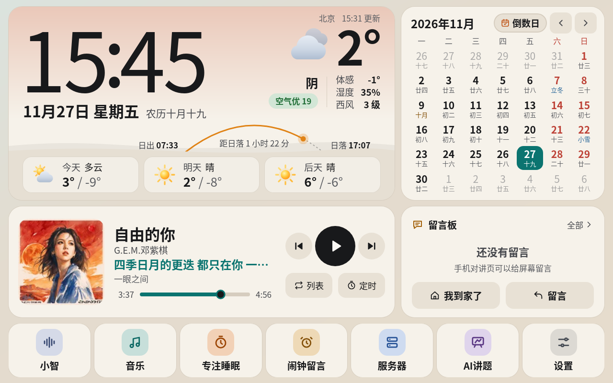
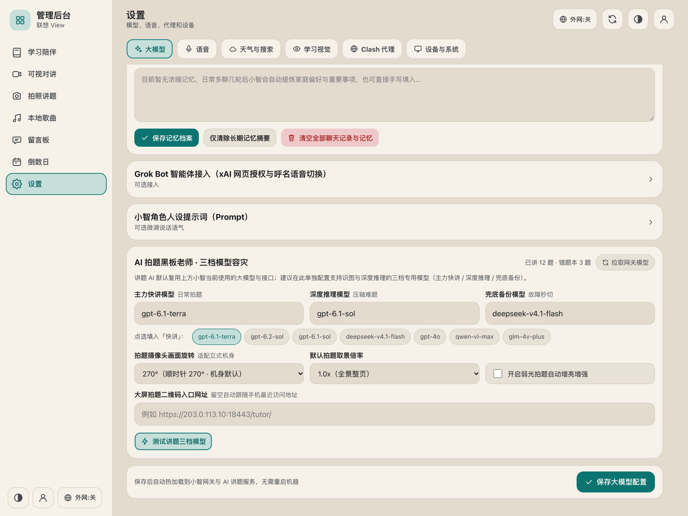
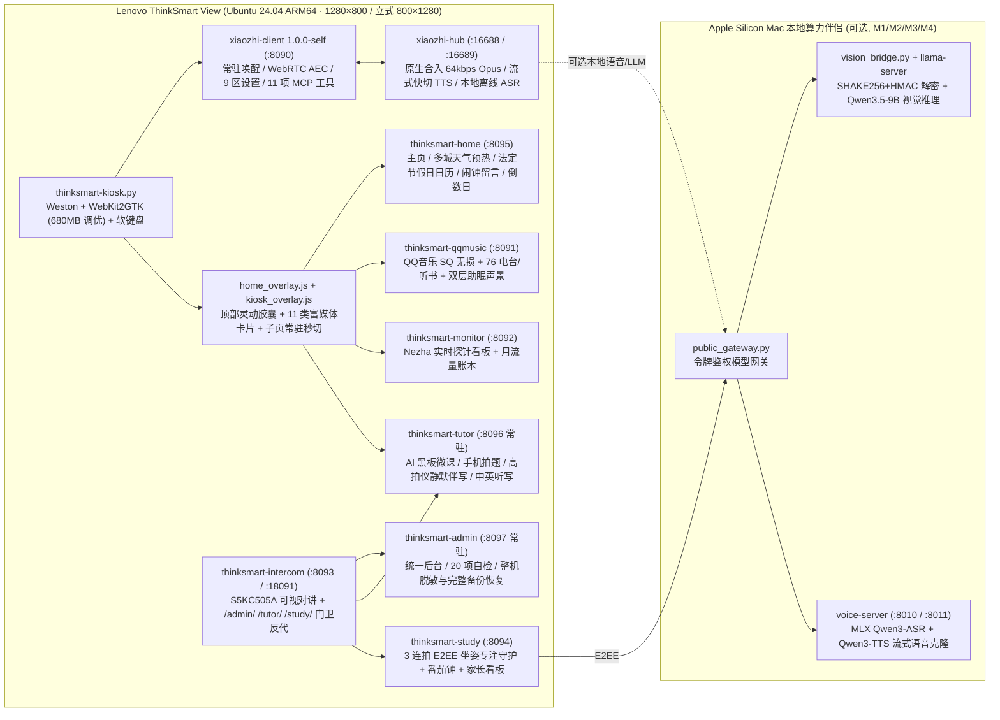

# ThinkSmart View (CD-18781Y) 一体化智能桌面中枢 & AI 拍题黑板全栈系统

**[🇨🇳 简体中文](README.md) | [🇺🇸 English](README_EN.md)** · **[📘 安装后配置清单与大模型选型指南](docs/USER_GUIDE.md)**

将联想 **ThinkSmart View（型号 `CD-18781Y`：Qualcomm APQ8053 / 2GB RAM / 8GB eMMC / 8" `1280×800` IPS 触控屏 / TAS5782M Hi-Fi 功放 / 双数字麦克风阵列 / S5KC505A 前置摄像头 / BMA253 重力传感器）** 彻底改造为一台运行在 **Ubuntu 24.04 + Wayland (Weston) + PipeWire** 上的**原生融合语音智能桌面中枢 + AI 动态黑板讲题教师 + 统一网页管理后台**，并可选配套 **Apple Silicon Mac (`MLX` / `llama.cpp`)** 本地低延迟语音克隆与端到端加密视觉算力伴侣。

---

## 核心升级亮点与必读须知

> [!IMPORTANT]
> **1. 原生融合架构（告别外挂补丁与独立黑屏语音页）**
> - **小智双核心原生收编**：已将语音客户端（`device/xiaozhi-client/`，`1.0.0-self`）与本地对话中枢（`device/xiaozhi-hub/`，`:16688`/`:16689`）完整原生合入本仓库（内置 WebRTC 回声消除混音桥接、11 项整机屏幕/音乐/黑板/系统 MCP 语音工具、`64kbps` Opus、流式 TTS 首字快切与进程内 WAV 极速解码），永久停用第三方在线自动覆盖更新。
> - **顶部「灵动胶囊 + 11 类可交互富媒体卡片」**：默认唤醒词 **`你好小智`**。唤醒不再切换黑屏语音页，直接在当前页面顶部浮出**灵动胶囊**与**富媒体交互卡片**（天气、无损音乐、闹钟、计时器、倒数日、留言、新闻、服务器、AI 讲题、亮度、音量均可直接点按操控；听歌唤醒自动柔和压低音量 `listen_duck` 并支持免唤醒连续追问）。
> - **全新 9 分区触控设置中心 & 全模块常驻秒开**：大屏内置 `显示 / 声音 / 网络 / 小智 / 对话 / 天气 / 音乐 / 学习 / 系统` 9 大分区，支持触屏选 Wi-Fi 填密码、AirPlay 投屏与蓝牙音箱一键开关、**输入拼音或汉字实时搜索全国区县城市天气**；核心服务与子页常驻内存预热，AI 讲题、管理后台、歌单与设置均在 **`5～20 ms` 内零等待秒开**。

> [!TIP]
> **2. 统一网页管理后台（`/admin/`）与 AI 拍题黑板老师（`/tutor/`）硬件黄金搭配**
> - **统一管理后台默认账号密码与安全门控**：局域网打开 `http://<设备局域网IP>:18091/admin/`，首次安装初始账号 **`admin`**、初始密码 **`admin`**；**外网访问默认关闭（`外网:关`，返回 HTTP `403`）**，仅限内网或手动开启外网开关后访问；内置**「整机配置备份导出与恢复」**（支持一键导出脱敏分享包或含聊天记录/登录态的完整换机迁移包）。
> - **AI 讲题推荐「竖版立式 `800×1280`」+「带独立外接供电的 USB Hub」**：立式摆放让底部 Type-C 自然走线且纵向画幅完美契合试卷推导；外接 **USB 高拍仪**或 **U 盘**时，因机身 Type-C OTG 电流受限，**务必通过带独立 5V/PD 电源适配器的有源 USB Hub 连接**（系统内置 `thinksmart-usb-host` 与 `thinksmart-usb-watchdog` 自动守护自愈）。

---

## 全新机器从零安装完整指南（Step-by-Step）

> ⚠️ **机型严格核对**：本系统**仅支持 Lenovo ThinkSmart View `CD-18781Y`**（高通 `APQ8053`，8 英寸竖屏，机身背面/底部铭牌印有 `CD-18781Y`）。不支持 ThinkSmart View Plus 或其他型号。这台机器没有电源键，插电即开机。

整套新机安装分为 **「第一阶段：底层刷入 Ubuntu 24.04 底包」** 与 **「第二阶段：一键安装本仓库全栈系统」** 两步，全程约 **20～25 分钟**。

### 第一阶段：原厂新机刷入 Ubuntu 24.04 底包（约 15 分钟）

> 若您的机器**已经刷过**社区镜像 [`justhalfbit/thinksmart-ubuntu-image`](https://github.com/justhalfbit/thinksmart-ubuntu-image) 且能连 Wi-Fi SSH 登录，请**直接跳到「第二阶段」**！

#### 1. 电脑端准备工具与底包文件
准备一台 Windows / macOS / Linux 电脑（剩余磁盘空间 `> 20 GB`）及一根**支持数据传输的 USB-C 数据线**（直插电脑主板接口）：
1. 安装高通 EDL 刷机工具 [`bkerler/edl`](https://github.com/bkerler/edl)（Python 3.10+ 虚拟环境安装；Windows 首次进 EDL 时需打开 [Zadig](https://zadig.akeo.ie/)，勾选 `Options -> List All Devices`，选中 `QUSB__BULK (05C6:9008)` 安装 **`WinUSB`** 驱动，装一次永久有效）。
2. 新建刷机工作目录（如 `~/thinksmart-flash`），下载以下 3 个底层镜像并校验 SHA256：
   - **`lk2nd.img`**（引导链，仅原厂首刷需要）：下载自 [`rickx/ubuntu-thinksmart` prebuilt/lk2nd.img](https://github.com/rickx/ubuntu-thinksmart/raw/main/prebuilt/lk2nd.img)（SHA256: `c81b036c75028c3d5aa915c72c89e075bc044360fe964c2ec0afb1d4a6f5209b`）
   - **`bootstrap-pmos-ssh-generic-qcom-msm8953.img`**（临时改分区表系统，仅原厂首刷需要）：下载自 [`rickx/ubuntu-thinksmart` bootstrap-2026-05-22](https://github.com/rickx/ubuntu-thinksmart/releases/tag/bootstrap-2026-05-22)（SHA256: `7d79db19b0911647bf6ab0a9a2924ef5cf83b4674798a54acdcbd41cdf07921b`）
   - **`thinksmart-ubuntu-20261101.img.xz`**（Ubuntu 24.04 基础底包）：下载自 [`justhalfbit/thinksmart-ubuntu-image` Releases](https://github.com/justhalfbit/thinksmart-ubuntu-image/releases)，使用 `xz -dk` 或 `7-Zip` 解压出约 `3.46 GB` 的 `.img` 文件。

#### 2. 按键进入 EDL（9008）模式并备份原厂整盘固件（必做！）
1. 拔掉设备电源线与 USB 线，静置等待 **30 秒**。
2. 插上 USB 数据线连接设备与电脑。
3. **同时按住机身顶部的「音量 +」和「音量 −」两颗按键不放**，插上圆口电源线，保持按住 **3～5 秒**后松开（此时**屏幕保持全黑**即为正常进入 EDL 模式）。
4. 在工作目录终端确认识别到 `APQ8053` 并**整盘备份新机独有的原厂 eMMC**（含序列号与射频校准，切勿省略或覆盖其他机器的备份）：
   ```bash
   edl printgpt 2>&1 | tee gpt-before.txt
   # 确认输出包含 CPU detected: "APQ8053" 与 total_blocks:15269888 后，备份整盘（约 7.8 GB）：
   edl rf stock-full-emmc-machine1.bin
   ```

#### 3. 刷入引导、改写分区表并写入 Ubuntu 24.04 底包
1. **刷入 `lk2nd` 与 `bootstrap` 临时系统**（若刚才跑完 `edl rf` 退出了 EDL，重新断电 30 秒后按住音量 `+`/`−` 插电重进一次 EDL）：
   ```bash
   edl w boot lk2nd.img
   edl w system bootstrap-pmos-ssh-generic-qcom-msm8953.img
   edl reset
   ```
2. **在设备屏幕上改写 GPT 分区表**（将零碎安卓分区合并为 `6.8 GB` 的 `system` 分区）：
   - 等待设备自动启动进入 `postmarketOS` 黑底白字终端（屏幕下半部分自带触控软键盘 `fbkeyboard`）；
   - 输入用户名 `root` 登录，在屏幕终端输入并回车执行：
     ```bash
     sudo /usr/local/sbin/apply-ubuntu-gpt.sh
     ```
   - 屏幕打印 **`GPT rewrite complete.`** 后，拔掉电源线并静置等待 **30 秒**。
3. **刷入正式 Ubuntu 24.04 底包镜像**：
   - 再次按住「音量 +」与「音量 −」插电进入黑屏 EDL 模式，执行：
     ```bash
     edl w system thinksmart-ubuntu-20261101.img
     edl reset
     ```
4. **首次开机配网**：
   - 设备自动重启并在后台将根分区 `/` 扩满整盘，随后进入触控欢迎页；
   - 在屏幕上选择家庭 Wi-Fi 并输入密码连接，通过路由器后台或局域网扫描（如 `nmap -p 22,16688 --open 192.168.1.0/24`）获取 `<设备局域网IP>`；
   - 使用 `ssh ubuntu@<设备局域网IP>` 登录（底包初始默认密码见社区底包说明，**强烈建议首次登录后立即通过 `passwd` 与 `sudo passwd root` 修改系统默认 SSH 密码**）。

---

### 第二阶段：一键安装本仓库一体化全栈系统（约 2～3 分钟）

本仓库提供 **「方式 A：在线 Git 一键安装（推荐）」** 与 **「方式 B：全离线一体包安装（适合无外网或批量克隆新机）」** 两种方式，脚本支持重复幂等执行：

#### 方式 A：设备联网直接一键安装（推荐大多数用户）

SSH 登录到刚连上 Wi-Fi 的设备，执行以下 4 行命令即可自动装齐全部核心代码、系统依赖包、Python 运行环境、前置摄像头 `S5KC505A` 设备树补丁、`UxPlay 1.74` 重力旋转投屏、蓝牙高清 `AAC` 编码及全部常驻/守护服务：

```bash
git clone https://github.com/fubin0478/thinksmart-view.git
cd thinksmart-view
bash device/install.sh --check          # 装前只读结构与脚本 AST 语法校验
sudo bash device/install.sh --apply     # 一键全量部署（首次自动初始化唤醒词「你好小智」与后台口令 admin/admin）
sudo reboot                             # 重启以激活前置摄像头设备树、PipeWire 音频规则与常驻预热服务
```

#### 方式 B：全离线裸机装机包安装 / 从老机器一键克隆迁移配置

若您有多台设备需要批量装机，或希望将现役机器的配置（闹钟、城市、唤醒词、API Key、QQ 音乐登录态等）一键迁移到新机器：

1. **导出备份或生成离线装机包（可选）**：
   - 在老机器网页后台 `http://<老机器IP>:18091/admin/` →「系统与设备」→ **「整机配置备份导出与恢复」**，可一键导出 **「脱敏配置包」** 或 **「完整迁移备份包」**（或命令行执行 `sudo /usr/local/sbin/thinksmart-backup export --mode full --out /tmp/ts-backup.tar.gz`）；
   - 如需构建包含全量 `.venv` 虚拟环境、离线唤醒/VAD 模型与 `mihomo` 二进制的 `~273 MiB` 独立离线装机包，在开发机执行：`python tools/build_baremetal_package.py --out-dir ./dist`。
2. **在新机器上一键离线部署（支持连同备份包一步恢复）**：
   ```bash
   mkdir -p /tmp/ts-installer
   tar -xzf /tmp/thinksmart-baremetal-installer-20261125.tar.gz -C /tmp/ts-installer
   bash /tmp/ts-installer/install.sh --check

   # 全新干净安装：
   sudo bash /tmp/ts-installer/install.sh --apply
   # 或：安装同时一步导入备份包恢复整机配置：
   # sudo bash /tmp/ts-installer/install.sh --apply --restore-backup /tmp/ts-backup.tar.gz

   sudo reboot
   ```

---

### 第三阶段：重启后 3 分钟开箱自检与首次配置

1. **运行整机只读健康自检**：
   ```bash
   /usr/local/bin/diagnose-wake.sh
   ```
   确认末尾输出 **`诊断结果：0 个错误，0 个警告。`**（自动核验摄像头 `/dev/video0`、麦克风管道、息屏/接近唤醒守护、AirPlay 与小智语音链路）。
2. **登录统一网页管理后台完成首次配置（唯一必配仅需 1 个大模型 API Key）**：
   - 同一局域网电脑或手机浏览器打开：**`http://<设备局域网IP>:18091/admin/`**（亦可在设备大屏点「设置 → 网络」直接用手机扫码打开）；
   - 输入初始用户名 **`admin`**、初始密码 **`admin`** 登录，先在右上角修改管理员密码（命令行修改：`printf 'admin:新密码\n' | sudo /usr/local/sbin/thinksmart-set-admin-password`）；
   - 在 **「大模型」** 卡片填入任意一家云端大模型 API Key（如智谱免费 `glm-4-flash`、DeepSeek `deepseek-chat`、阿里云百炼 `qwen-flash` 等）并保存；
   - 按需在后台填入 **AI 拍题黑板老师 3 档视觉/推理模型**（未填时自动继承小智主模型）与 **和风天气 API Host/Key**（完整清单见 **[《安装后配置与大模型选型指南》](docs/USER_GUIDE.md)**）。
3. *(多机并存提示)* 若从老机器导入了「完整迁移备份」且两台设备同时插电在线，请在新机器停用或修改公网反向隧道端口（`sudo systemctl disable --now thinksmart-intercom-tunnel.service`），避免两台设备争抢同一远端隧道端口。

---

## 实机成品界面总览

### A. 桌面原生融合交互（顶部灵动胶囊 · 七格底栏 · 立式自适应）

| 唤醒「你好小智」顶部灵动胶囊 + 可触控富媒体卡片 | 融合桌面主页（日出弧线 / 农历倒数日 / 无损歌词 / 七格底栏） |
| :---: | :---: |
|  |  |
| **告别独立黑屏语音页 · 原位弹出交互卡片 · 听歌自动柔降音量** | **子页常驻内存 5~15ms 秒开 · 日出日落自动切换暖米浅色/深色** |

| 9 分区系统设置（丝滑触控滑条 / AirPlay 投屏 / 蓝牙音箱） | 天气拼音/汉字实时搜城 + 触屏选 Wi-Fi 与统一后台扫码 |
| :---: | :---: |
|  |  |
| **显示 / 声音 / 网络 / 小智 / 对话 / 天气 / 音乐 / 学习 / 系统** | **支持拼音或城市名实时检索全国县区市 · 最多管理 8 个常看城市** |

<details>
<summary>点击展开：触屏 Wi-Fi 选网与统一后台入口（<code>1280×800</code>）及立式竖屏主页「接下来」日程条（<code>800×1280</code>）</summary>

| 设置 → 网络（触屏选 Wi-Fi 填密码 & 手机扫码进总后台） | 立式竖屏主页（`800×1280` 重力自适应 + 专属「接下来」日程条） |
| :---: | :---: |
|  |  |

</details>

---

### B. AI 拍题黑板老师（推荐竖版 `800×1280` · 手机拍题 + 高拍仪静默伴写 + 自助听写）

| 竖版动态电子黑板（推荐立式 `800×1280`） | 高拍仪静默伴写与错因巡检（`800×1280`） | 手机拍照传题与切题工作台（`/tutor/`） |
| :---: | :---: | :---: |
|  |  |  |
| **矢量黑板 · 苏格拉底分步引导 · 举一反三** | **停笔自动批改 · 定位错因步 · 零语音打扰** | **局域网扫码直传 · 透视裁边 · 去阴影增白** |

<details>
<summary>点击展开：横版（<code>1280×800</code>）动态黑板讲题布局</summary>


</details>

---

### C. 统一网页管理后台（`:18091/admin/`）与音乐 / 专注 / 服务器看板

| 全栈大模型总控 & `外网:关` 安全开关 | AI 讲题独立 3 档大模型与高拍仪设置 | 本地 EdgeTTS 语音合成 & Sherpa-ONNX 离线识别 |
| :---: | :---: | :---: |
|  |  |  |

| 无损音乐与 76 路高清电台 / 听书 | 番茄专注计时与自然双层声景 | 服务器实时探针与账期流量看板 |
| :---: | :---: | :---: |
|  |  |  |

---

## 系统架构与模块矩阵



| 目录 | 设备运行路径 | 说明 |
| --- | --- | --- |
| [`device/xiaozhi-client/`](device/xiaozhi-client/) | `/opt/thinksmart/client/1.0.0-self` (`current` 软链) | 自主版语音客户端：Sherpa-ONNX 中文唤醒、硬件 WebRTC AEC 桥接、11 项 `self.*` 屏幕/播控工具与 `:8090` 9 分区设置宿主 |
| [`device/xiaozhi-hub/`](device/xiaozhi-hub/) | `/home/ubuntu/xiaozhi-hub-server` | 自主版语音对话中枢：原生合入 `64kbps` Opus、流式 TTS 首句快切、本机离线 ASR、音乐/天气/联网搜索插件与连接池复用 |
| [`device/home/`](device/home/) | `/usr/local/bin/thinksmart-home.py` (`:8095`) | 自有桌面主页：多城天气后台保鲜、国务院节假日/调休工作日历、双向语音留言板、公农历倒数日、桌面计时器与竖版「接下来」 |
| [`device/qqmusic/`](device/qqmusic/) | `/usr/local/bin/thinksmart-qqmusic.py` (`:8091`) | 独立 QQ 音乐 HD：扫码绿钻 VIP 自动续期、`SQ FLAC` 无损、76 路电台/听书断点续播、U 盘曲库与双层助眠白噪音 |
| [`device/monitor/`](device/monitor/) | `/usr/local/bin/thinksmart-monitor.py` (`:8092`) | 哪吒多节点实时监控看板 + 顶层全屏路由与灵动胶囊叠加层 `home_overlay.js` |
| [`device/tutor/`](device/tutor/) | `/usr/local/bin/thinksmart-tutor.py` (`:8096`) | 常驻内存 AI 拍题黑板老师：苏格拉底 4 步启发、手机整页作业夹、USB 高拍仪静默伴写、中英自助听写与艾宾浩斯错题本 |
| [`device/admin/`](device/admin/) | `/usr/local/bin/thinksmart-admin.py` (`:8097`) | 常驻内存统一 Web 管理后台：全链路模型/语音/唤醒词配置、20 项在线自检、Clash 代理面板与整机备份导出/恢复 |
| [`device/intercom/`](device/intercom/) | `/usr/local/bin/thinksmart-intercom.py` (`:18091`) | 前置摄像头 `15fps` 全双工可视对讲（空闲零占用休眠）+ `/admin/`、`/tutor/`、`/study/` 内外网三通道安全反代门卫 |
| [`device/study/`](device/study/) | `/usr/local/bin/thinksmart-study.py` (`:8094`) | 书桌坐姿与专注陪伴守护（`SHAKE256 + HMAC` 端到端密封三连拍、零照片落盘、手机家长统计页 `/study/`） |
| [`device/kiosk/`](device/kiosk/) & [`device/system/`](device/system/) | `/usr/local/bin/*` + `/usr/local/sbin/*` | WebKit2GTK 全屏容器、虚拟软键盘、ALS 环境光调光、息屏 `SIGSTOP` 0% CPU 休眠、`UxPlay 1.74` 投屏、USB 看门狗与 `thinksmart-backup` |
| [`device/prebuilt/arm64/`](device/prebuilt/arm64/) & [`device/configs/`](device/configs/) | `/boot/*.dtb` + `/etc/systemd/*` + PipeWire | 经 SHA256 校验的前置摄像头设备树补丁、软 ISP 采集器、AirPlay 重力旋转库、蓝牙 AAC 插件与 58 项底层 systemd/音频防爆音规则 |
| [`tools/`](tools/) | 开发机跨平台维护工具 | `sync_device.py`（SHA256 零漂移对比、自动备份与按模块热同步）与 `build_baremetal_package.py`（生成全离线裸机装机包） |
| [`mac-companion/`](mac-companion/) | Apple Silicon Mac 选配算力端 | `MLX` 本地 `Qwen3-ASR` + `Qwen3-TTS` 多风格流式语音克隆与 `Qwen3.5-9B` 端到端加密伴学视觉桥接 |

---

## 日常开发同步与整机备份命令速查

```bash
# 1. 在开发机（Windows / macOS）只读对比主仓库与设备线上 375 项文件的差异
python tools/sync_device.py --host root@<设备IP> --diff

# 2. 原子备份并增量热同步有变更模块至真机 + 自动运行唤醒与红线自检
python tools/sync_device.py --host root@<设备IP> --apply --verify

# 3. 在设备端命令行导出脱敏配置备份包 / 完整迁移备份包
sudo /usr/local/sbin/thinksmart-backup export --mode sanitized --out /tmp/ts-sanitized.tar.gz
sudo /usr/local/sbin/thinksmart-backup export --mode full --out /tmp/ts-full.tar.gz
```

---

## 隐私与安全设计

- **仓库全量脱敏与零凭据**：仓库不含任何真实密码、API Key、Cookie、Refresh Token、公网隧道 IP/域名、家庭 Wi-Fi 名称及图片 EXIF/附属块元数据；所有密钥与口令哈希（`scrypt`）仅在设备本地 `0600`/`0700` 权限目录内运行期生成与读写。
- **内网优先 + `外网:关` 显式门控**：`/admin/`、`/tutor/`、`/study/` 默认对公网入口严格返回 `403`，仅限家庭局域网登录或由管理员在后台显式开启外网开关后放行。
- **硬件音频与 eMMC 护盘红线**：禁止字节码落盘（`PYTHONDONTWRITEBYTECODE=1`）、日志与缓存容量硬封顶、`zram` 压缩交换内存调优，并在同步脚本中内置 MSM8953 音频栈与活跃通话防打断保护。

---

## License

Copyright (c) 2026 fubin0478. 本项目采用 [GNU General Public License v3.0 (GPL-3.0)](LICENSE) 开源许可协议发布（[`device/prebuilt/arm64/`](device/prebuilt/arm64/) 下的预编译硬件增强组件遵循其各自上游开源协议，详见 [`device/prebuilt/arm64/README.md`](device/prebuilt/arm64/README.md)）。
