# ThinkSmart View (CD-18781Y) 桌面智能中枢 & AI 拍题黑板全栈套件

**[🇨🇳 简体中文](README.md) | [🇺🇸 English](README_EN.md)** · **[📘 安装后配置与大模型选型指南](docs/USER_GUIDE.md)**

将联想 **ThinkSmart View (`CD-18781Y`, Qualcomm APQ8053 / 8" 1280×800 IPS 触控屏 / TAS5782M Hi-Fi 功放 / 双数字麦克风 / S5KC505A 摄像头 / BMA253 重力传感器)** 改造为一台运行在 **Ubuntu 24.04 + Wayland (Weston) + PipeWire** 上的全功能**家庭桌面智能中枢 + AI 拍题互动黑板教师 + 统一网页管理后台**，并可选配套 **Apple Silicon Mac (MLX / llama.cpp)** 本地语音克隆与端到端加密视觉算力后端。

> **零侵入解耦设计**：所有自研服务均隔离运行于 `/usr/local/{bin,sbin,share,lib}` 与 `/opt/thinksmart-addons/`，对第三方小智语音客户端采用 `sitecustomize.py` Git-Blob 哈希校验热挂载（上游在线升级时自动安全回退，绝不阻塞启动或丢失定制功能）。

---

## 本次核心新增功能与硬件使用须知

> [!IMPORTANT]
> **1. 统一网页管理后台（`/admin/` · 默认密码 `admin` / `admin` · 默认仅内网）**
> - **默认管理员账号与密码**：首次安装时自动创建初始用户名 **`admin`**、初始密码 **`admin`**（可在管理后台内修改，或 SSH 执行 `sudo /usr/local/sbin/thinksmart-set-admin-password`）。
> - **默认仅限局域网内网登录**：打开 `http://<设备局域网IP>:18091/admin/` 集中管理可视对讲、家庭留言、倒数日、学习陪伴、AI 讲题大模型、本地歌曲、TTS/ASR 音色识别、QQ 音乐与代理节点。
> - **外网访问默认关闭（`外网:关`，HTTP `403`）**：为保障家庭内网与隐私安全，外部隧道对 `/admin/` 的访问在出厂/重装后默认处于关闭状态；如确需外网远程调整配置，可在管理后台顶部或左下角点击 **`外网:关`** 按钮手动开启或随时关闭（现有免密反向隧道规则保持不变）。

> [!TIP]
> **2. AI 拍题黑板老师（`/tutor/`）· 双重出题方式 & 硬件黄金搭配**
> - **方式一：手机拍照传题（`/tutor/` 手机工作台）** —— 手机扫码或打开 `http://<设备局域网IP>:18091/tutor/` 随手拍题、自动/手动梯形裁边增白，一键推送至 ThinkSmart View 屏幕开启**矢量动态黑板分步精讲 + 语音互动追问 + 艾宾浩斯错题复习闭环**。
> - **方式二：USB 高拍仪俯拍 + 静默伴写** —— 外接高拍仪实时俯拍桌面作业，支持**触屏画框单题精讲**与**静默伴写巡检**（停笔数秒后后台静默批改整页、只提示易错点不打断思路）。
> - **强烈推荐「竖版立式 `800×1280`」使用 AI 讲题**：竖放后底部 Type-C 接口自然留空走线，纵向视野完美适配 A4/B5 竖排试卷、多步解题推导与互动黑板；系统通过 `BMA253` 重力传感器自动扶正旋转，也支持顶部栏一键切换横/竖屏锁定。
> - **高拍仪 / U 盘必须使用「带独立外接供电的 USB Hub」**：ThinkSmart View 底部 Type-C OTG 供电能力有限，接 USB 高拍仪、U 盘或键鼠等外设时，**务必配合带独立 5V/PD 供电的 USB Hub（拓展坞）使用**，否则高拍仪工作瞬时电流容易引发掉盘。套件内置 `thinksmart-usb-host` 与 `thinksmart-usb-watchdog` 提供断连自愈与供电监测保护。
> - **讲题 AI 需单独配置大模型（默认复用小智大模型）**：未在后台单独填写「讲题模型」时，AI 讲题会自动继承小智对话当前使用的大模型；为获得更稳定的试卷 OCR、几何辅助线 SVG 绘制与数理逻辑推导体验，**推荐在后台「设置 → 大模型 → AI 拍题黑板老师」中单独指定 3 档模型**（主力快讲 / 深度推理 / 兜底备份，详见 [`docs/USER_GUIDE.md`](docs/USER_GUIDE.md)）。

---

## 实机成品界面总览

### A. AI 拍题黑板老师（推荐竖版 `800×1280` · 手机拍题 + 高拍仪伴写）

| 竖版动态电子黑板（推荐立式 `800×1280`） | 高拍仪静默伴写与错因巡检（`800×1280`） | 手机拍照传题与切题工作台（`/tutor/`） |
| :---: | :---: | :---: |
| 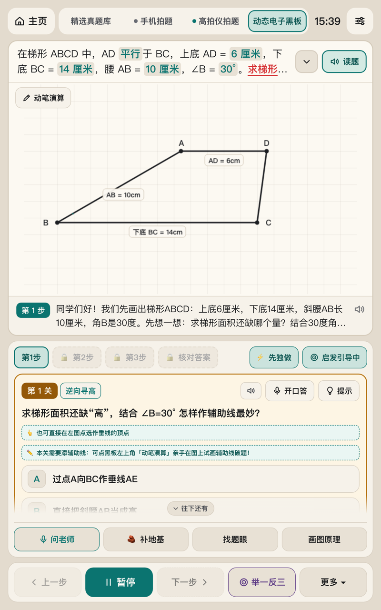 | 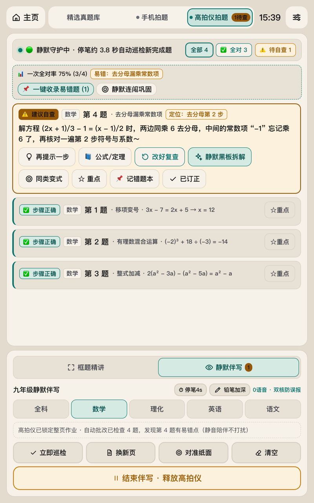 | 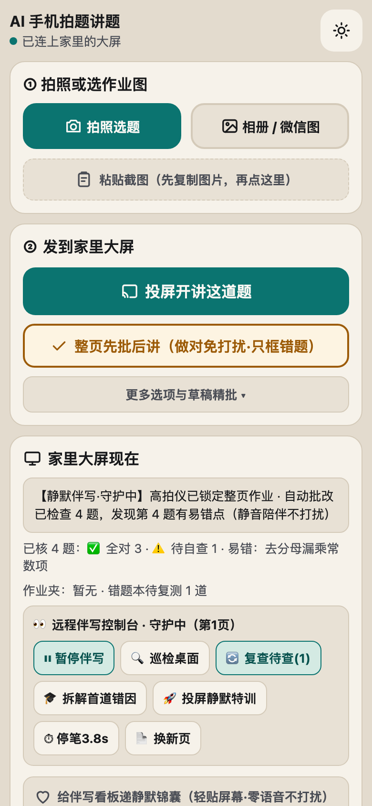 |
| **矢量黑板 · 启发引导 + 手画辅助线 + 举一反三** | **停笔自动批改 · 定位错因步 · 0语音防打扰** | **局域网扫码直传 · 四角透视裁边 · 增白增强** |

<details>
<summary>点击展开：横版（<code>1280×800</code>）动态黑板讲题布局（支持重力自动切换与手工锁定）</summary>

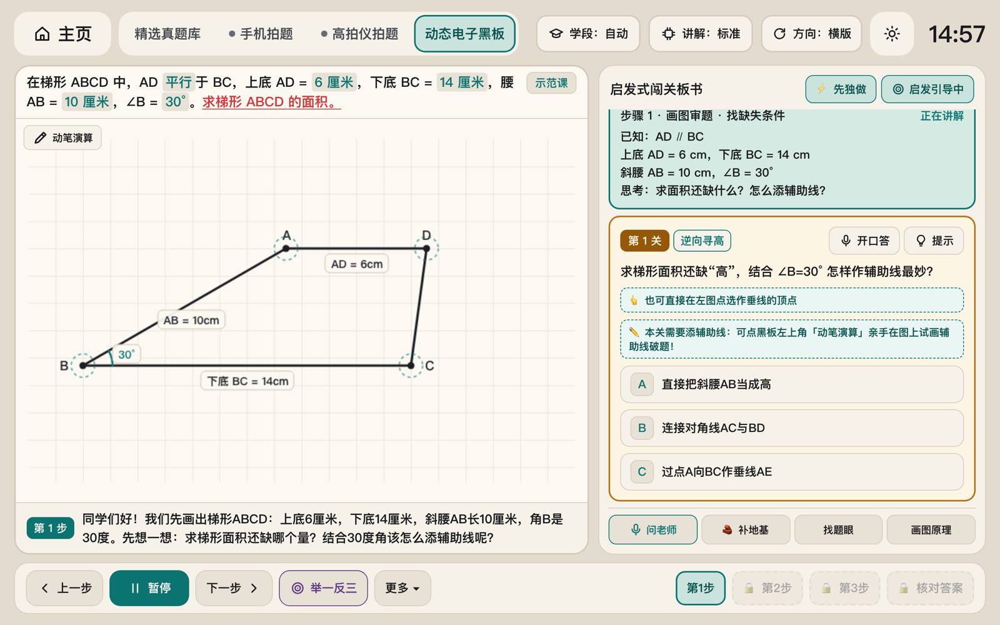

</details>

---

### B. 统一网页管理后台（`/admin/` · 初始 `admin` / `admin` · `外网:关` 默认关闭）

| 全栈大模型总控 & `外网:关` 安全开关 | AI 讲题独立 3 档大模型与高拍仪设置 | 本地 EdgeTTS 语音合成 & Sherpa-ONNX 离线识别 |
| :---: | :---: | :---: |
| 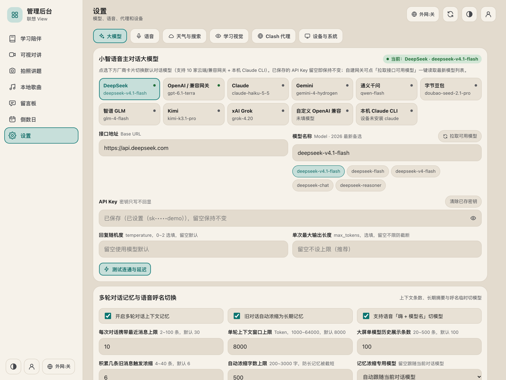 |  | 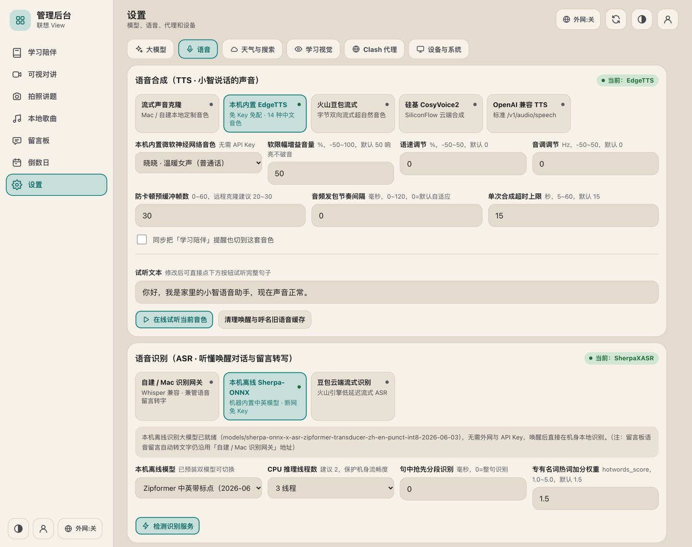 |
| **一键切换小智主模型 · 实时显式标示外网开关状态** | **主力快讲 / 深度推理 / 兜底备份 · 默认继承小智** | **免 Key 14 种内置音色 · 本机离线中英识别模型** |

---

### C. 家庭桌面智能中枢（`1280×800` 触控屏）

| 桌面智能主页（天气 / 日历 / 留言 / 音乐） | 无损音乐与 76 路高清电台 / 听书 |
| :---: | :---: |
| 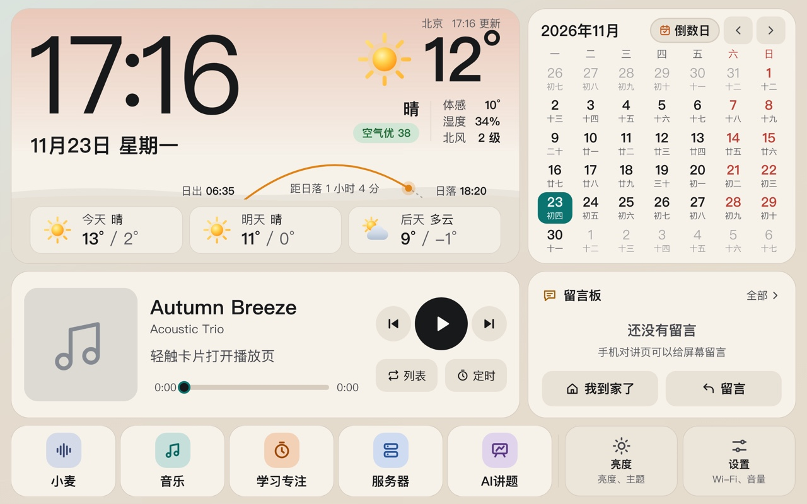 | 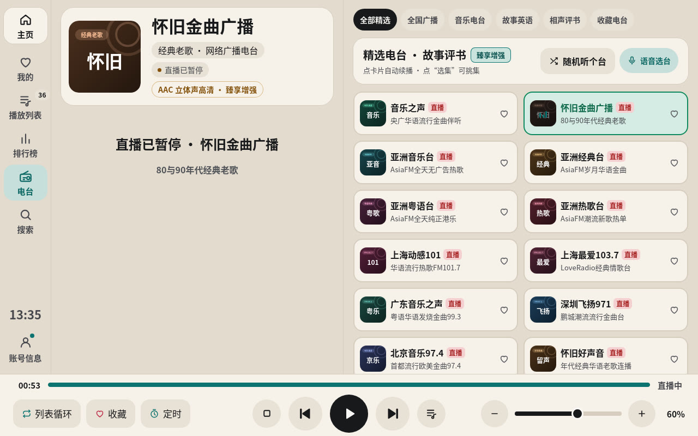 |
| **多城天气、公农历生日倒数日、家庭留言板与日出浅色换肤** | **SQ 无损 FLAC、28 路高音质电台、48 路故事评书与母带音效** |

| 番茄专注计时与自然双层声景 | 服务器实时探针与账期流量看板 |
| :---: | :---: |
| 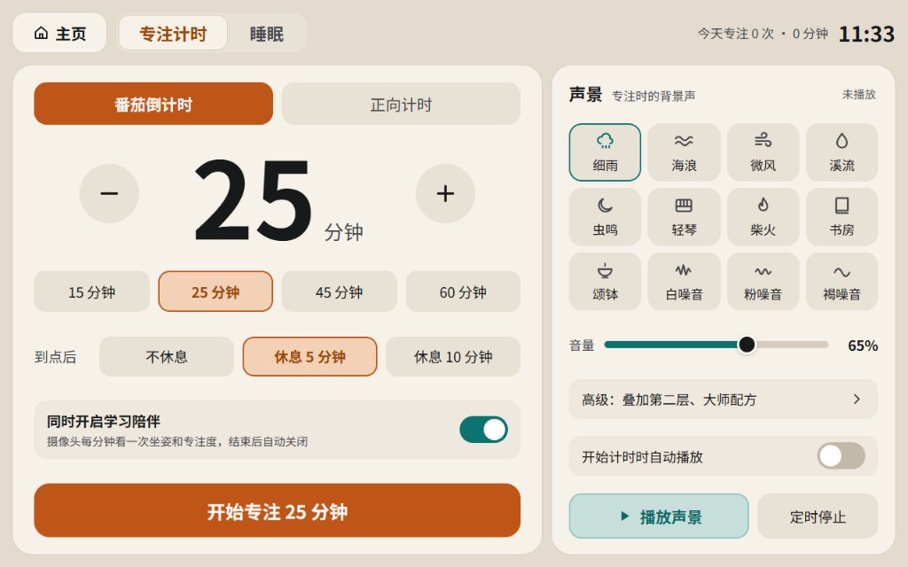 | 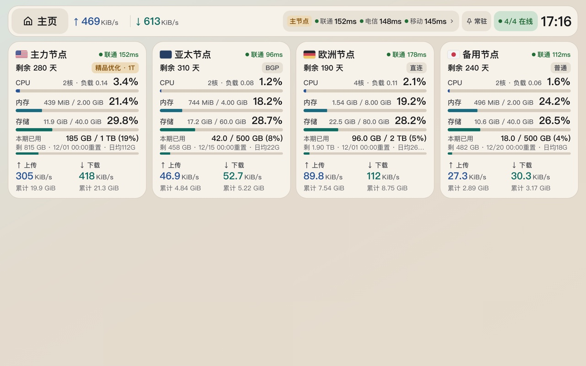 |
| **联动摄像头坐姿专注陪伴、睡眠渐暗白噪音混音** | **Nezha 多节点三网延迟、月度账期校准与按需省流连接** |

---

## 系统架构总览

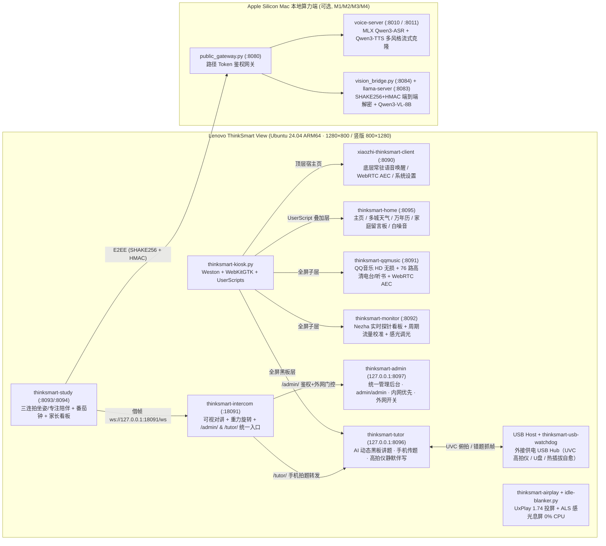

---

## 核心功能模块

### 1. 设备端套件 (`device/`)

| 目录 | 服务 / 组件 | 核心特性 |
| --- | --- | --- |
| [`device/admin/`](device/admin/) | `thinksmart-admin.py` (`127.0.0.1:8097`, 入口 `:18091/admin/`) | **统一网页管理后台**：一页集中控制小智系统设置（大模型、EdgeTTS/语音克隆、Sherpa-ONNX 离线/云端 ASR、唤醒词/热词/纠错、天气与搜索 API）、**AI 讲题 3 档独立大模型**、高拍仪与提示语参数、可视对讲、家庭留言与倒数日、学习陪伴、本地歌曲与 Clash 代理；内置 **`admin` / `admin` 初始口令鉴权、LAN/VPN 优先访问与 `外网:关` 手动门控**。 |
| [`device/tutor/`](device/tutor/) | `thinksmart-tutor.py` (`127.0.0.1:8096`, 手机入口 `:18091/tutor/`) | **AI 拍题黑板老师 & 高拍仪静默伴写**：支持**手机扫码拍照透视裁边传题**与 **USB 高拍仪俯拍框题**双输入；提供动态 SVG 几何绘图、分步启发引导、真人板书配音、语音随时追问、脱敏举一反三变式与**艾宾浩斯错题复习本**；「静默伴写」模式可全页静音盯防、停笔自动批改并轻量预警错题步；默认继承小智大模型，推荐竖版 `800×1280` 立式交互。 |
| [`device/home/`](device/home/) | `thinksmart-home.py` (`:8095`) | **桌面主页与生活组件**：和风天气全屏详情页（多城市秒切、24 小时曲线、7 日温差条、国标 6 项空气质量与生活指数）、农历节气万年历、**三端倒数日与公农历生日（含闰月与周岁换算）**、**家庭双向语音/文字留言板与定时提醒**、**助眠白噪音双层混音 + 晨间日出渐亮叫醒**、番茄专注计时；深色 / 暖米浅色随日出日落自动切换。 |
| [`device/qqmusic/`](device/qqmusic/) | `thinksmart-qqmusic.py` (`:8091`) | **独立无损音乐与 76 路电台/有声书服务**：扫码登录同步绿钻 VIP 与「我喜欢」歌单、SQ 无损 FLAC 经 `ffmpeg + SoXR (precision=28)` 直出 `48kHz F32LE`、逐行歌词与三档母带音效（`臻享增强 / 清澈人声 / 原声直通`）；内置 **28 路高清音乐电台 + 22 路全国省市广播 + 16 路少儿故事英语 + 10 路相声评书**并支持断点续播；通过 `aec_bridge_sitecustomize.py` 无侵入桥接 WebRTC 回声消除。 |
| [`device/monitor/`](device/monitor/) | `thinksmart-monitor.py` (`:8092`) | **服务器实时状态看板与顶栏叠加层**：按需连接 Nezha WebSocket（页面关闭 90 秒后断开省流量）、月度账期双向流量校准、单机延迟曲线；`home_overlay.js` 常驻覆盖主页、音乐、监控与讲题入口，并带顶部语音胶囊条 `#tsVoicePill` 随时唤醒小智。 |
| [`device/intercom/`](device/intercom/) | `thinksmart-intercom.py` (`:18091`) | **远程可视对讲与统一局域网/隧道网关**：调度机身 S5KC505A 摄像头并联动物理镜头盖 (`gpio87`) 与静音键 (`gpio86`)、`BMA253` 重力扶正，支持全双工通话、手机倒数日/留言管理，并作为 `/admin/` 与 `/tutor/` 的鉴权/外网门控统一反代入口（反向隧道模版见 `thinksmart-intercom-tunnel.sh`）。 |
| [`device/study/`](device/study/) | `thinksmart-study.py` (`:8093` / `:8094`) | **AI 学习坐姿与专注陪伴**：手动开启（带 3 小时自动关闭安全锁），每分钟 3 张跨 8 秒连拍过滤瞬间动作，经 **SHAKE256 + HMAC-SHA256 端到端加密**送交本地视觉模型或云端视觉 API 识别坐姿/趴桌/走神/玩手机，连续命中温和语音提醒；内置手机/电脑家长看板（零照片落盘）。 |
| [`device/system/`](device/system/) | `idle-blanker.py` / `thinksmart-usb-watchdog` / `thinksmart-airplay.py` 等 | **底层电源、USB 自愈守护与投屏调度**：ALS 环境光对数平滑调光、息屏 `SIGSTOP` 冻结 `WebKitWebProcess` 实现 0% CPU 休眠、`thinksmart-usb-host` 自动切 Host 供电识别外接带供电 USB Hub 中的高拍仪与 U 盘、`thinksmart-usb-watchdog` 监控 xHCI 异常自动自愈、UxPlay 1.74 AirPlay 镜像绑核提权。 |
| [`device/prebuilt/arm64/`](device/prebuilt/arm64/) | `s5kc505a_cam_helper` / `uxplay` / `.dtb` 等 | **ARM64 硬件增强预编译包（附 SHA256 校验与 DTS 补丁源码）**：含 `S5KC505A` 15fps 软 ISP 采集器与设备树补丁、定制版 `UxPlay 1.74`、`BMA253` NEON 重力旋转插件及 PipeWire `FDK-AAC` 蓝牙编码插件。 |
| [`device/xiaozhi-overrides/`](device/xiaozhi-overrides/) | `sitecustomize.py` + `files/` | **小智 Hub 无侵入热补丁加载器**：启动时逐文件校验官方 Git Blob SHA，匹配后挂载 `64kbps` Opus 全频带编码、流式 TTS 增强、QQ 音乐/黑板语音桥接及后台/SSRF 安全加固，上游更新后安全回退。 |
| [`device/configs/`](device/configs/) | `systemd` / `pam.d` / `pipewire` / `wireplumber` / `bluetooth` | **全链路 Hi-Fi 音频与系统加固配置**：PipeWire `48kHz` 原生时钟与心理声学抖动、蓝牙音箱免 PIN 高清配对、`thinksmart-admin.socket` / `thinksmart-tutor.socket` 按需拉起、`thinksmart-usb-watchdog.service` 常驻守护、QCA9379 Wi-Fi 省电关闭。 |
| [`device/tests/`](device/tests/) | `test_*.py`（29 套回归测试） | **自动化单元与接口回归测试**：完整覆盖统一后台与外网/内网鉴权门控 (`test_admin_20261120.py`)、竖版全页适配 (`test_allpages_portrait_20261120.py`)、高拍仪与静默伴写 (`test_cowrite_r92_20261122.py`、`test_tutor_doccam_20261120.py`)、USB Hub 热插拔、倒数日闰月、多城天气、留言板、电台续播与服务器监控安全边界。 |

### 2. Apple Silicon 本地算力配套端 (`mac-companion/`)

| 目录 | 组件 | 核心特性 |
| --- | --- | --- |
| [`mac-companion/voice-server/`](mac-companion/voice-server/) | `server.py` + `tts_speedups.py` + `public_gateway.py` | **MLX 本地语音识别与多风格流式克隆服务 (`:8010` / `:8011`)**：基于 `Qwen3-ASR-1.7B` 与 `Qwen3-TTS-12Hz-1.7B-Base`，在 M1 Pro 上实现 `~300ms` 首包延迟；支持 `calm / flow / warm / question` 四风格轮换、双进程并发溢出 (`TTS_OVERFLOW_URL`) 与副进程空闲自动休眠。 |
| [`mac-companion/study-vision/`](mac-companion/study-vision/) | `vision_bridge.py` + `llama-server` | **端到端加密视觉桥接 (`:8084` -> `:8083`)**：纯标准库 `SHAKE256 + HMAC-SHA256` 双向加解密与 `120s` 防重放，按设备重力角使用系统 `sips` 转正（0700 内存级即用即焚），调度本地 `Qwen3-VL-8B-Instruct` 或转发云端视觉大模型。 |

---

## 目录结构

```text
thinksmart-view/
├── README.md                 # 中文总览与快速部署指南
├── README_EN.md              # English Overview & Deployment Guide
├── docs/
│   ├── USER_GUIDE.md         # 安装后配置清单、后台/讲题设置与大模型选型指南（中文）
│   ├── USER_GUIDE_EN.md      # Post-Install Configuration & Model Selection Guide (English)
│   └── images/               # 实机成品界面截图（全量剥离 EXIF 与隐私信息）
├── device/
│   ├── install.sh            # 设备端一键二次安装、依赖补齐、初始 admin 口令与升级脚本
│   ├── diagnose-wake.sh      # 整机服务、USB 看门狗、摄像头与跨界面唤醒只读自检脚本
│   ├── admin/                # 统一网页管理后台（:8097，入口 :18091/admin/）
│   ├── tutor/                # AI 动态黑板讲题、手机拍照上传页与高拍仪静默伴写（:8096，手机入口 :18091/tutor/）
│   ├── home/                 # 桌面主页、多城天气、万年历、家庭留言板、助眠与番茄计时（:8095）
│   ├── qqmusic/              # 独立 QQ 音乐 HD 无损、76 路电台/听书与 WebRTC AEC 桥接（:8091）
│   ├── monitor/              # Nezha 服务器看板、流量校准、显示控制与顶栏叠加层（:8092）
│   ├── intercom/             # 远程可视对讲、/admin/ & /tutor/ 门控代理与反向 SSH 隧道脚本（:18091）
│   ├── study/                # AI 学习陪伴服务与家长统计面板（:8093 / :8094）
│   ├── kiosk/                # 首次联网 Wi-Fi 向导与触控虚拟软键盘资源
│   ├── prebuilt/arm64/       # 预编译摄像头 ISP、设备树补丁、UxPlay 1.74、NEON 旋转与蓝牙 AAC 插件
│   ├── system/               # 自动感光息屏、USB Host / Watchdog 看门狗、AirPlay 调度器与 Kiosk 启动器
│   ├── xiaozhi-overrides/    # 小智 Hub Git-Blob 校验无侵入热补丁加载器
│   ├── configs/              # systemd（含 admin/tutor socket 与 usb-watchdog）/ PAM / PipeWire / udev / sysctl
│   └── tests/                # 29 套设备端自动化单元与接口回归测试套件
└── mac-companion/
    ├── install-mac.sh        # Mac 算力端一键环境初始化与 LaunchAgent 生成脚本
    ├── voice-server/         # Apple Silicon MLX 本地 ASR + Qwen3-TTS 流式语音克隆与网关
    └── study-vision/         # 学习陪伴 E2EE 视觉桥接服务与 Qwen3-VL LaunchAgent 模板
```

---

## 快速部署指引

### 前置必读：刷机顺序与小智底座依赖关系

> **安装后怎么登录后台、外网开关在哪里、讲题选什么大模型？** 👉 请直接阅读 **[《安装后配置清单与大模型选型指南》](docs/USER_GUIDE.md)**。

本套件属于基于 **「小智语音底座」** 的全栈扩展套件，完整部署仅需两步，**无需**从零手工编译小智：

1. **第一步（刷入已内置小智的社区 Ubuntu 24.04 底包）**：
   - 按照 [`justhalfbit/thinksmart-ubuntu-image`](https://github.com/justhalfbit/thinksmart-ubuntu-image) 官方刷机指南，将社区固件刷入 `Lenovo ThinkSmart View (CD-18781Y)`。
   - 底包已预装 Ubuntu 24.04 ARM64、声卡/触控/光线传感器驱动、Weston 显示服务，以及常驻语音助手 [`xiaozhi-thinksmart-client`](https://github.com/justhalfbit/xiaozhi-thinksmart-client)（`thinksmart-client.service` `:8090`）与本地服务端 `xiaozhi-hub-server`（`:16688`）。
2. **第二步（运行本仓库一键安装脚本）**：
   - 设备连上 Wi-Fi 后，SSH 登录设备克隆本仓库并执行 `sudo bash device/install.sh`，首次安装后 `sudo reboot` 一次激活前置摄像头设备树与 USB 守护即可全部就绪。

---

### 一、设备端一键安装与初次登录（Ubuntu 24.04 ARM64）

```bash
git clone https://github.com/fubin0478/thinksmart-view.git
cd thinksmart-view
sudo bash device/install.sh
sudo reboot
# 重启后可随时运行只读自检，核对后台/黑板/USB 看门狗/跨界面唤醒链路：
bash device/diagnose-wake.sh
```

`device/install.sh` 会自动完成（支持重复幂等无损升级）：
- 自动补全 `python3-dbus`、`python3-gi`、`python3-smbus2`、`python3-yaml`、`python3-ruamel.yaml`、`python3-pil`、`v4l-utils`、`ffmpeg`、`gstreamer1.0-plugins-bad`、`libfdk-aac2` 等系统依赖，并建立独立 Python 虚拟环境 `/opt/thinksmart-addons/venv`；
- 部署 **统一后台 `thinksmart-admin.socket` (`127.0.0.1:8097`)**、**AI 讲题 `thinksmart-tutor.socket` (`127.0.0.1:8096`)** 与 **`thinksmart-usb-watchdog.service`**（按需激活，不空耗内存）；
- **自动初始化默认管理员与外网安全门控**（仅在首次安装未存在口令文件时创建，二次升级绝不覆盖您的现有密码与开关状态）：
  - 默认用户名与密码：**`admin` / `admin`**
  - 默认登录地址：**`http://<设备局域网IP>:18091/admin/`**（仅局域网/可信隧道可访问）
  - 默认外网策略：**已关闭（`外网:关`，HTTP `403`）**；需要外网查看或调参时，登录后台后点击顶栏或左下角 **`外网:关`** 按钮即可手动开启/关闭。
- 如需通过命令行重设管理员密码：
  ```bash
  printf 'admin:您的新密码\n' | sudo /usr/local/sbin/thinksmart-set-admin-password
  ```

> [!WARNING]
> **外接高拍仪 / U 盘供电提示**：设备底部 Type-C 口若直连无源扩展坞同时挂高拍仪，极易因电流过载导致高拍仪黑屏或频繁断开；**务必使用带独立 5V/PD 电源适配器供电的 USB Hub**，配合竖版立式摆放效果最佳。

#### 升级不覆盖的个性化设置建议

- **网页一键可视化修改**：推荐直接使用 `http://<设备局域网IP>:18091/admin/` 修改小智大模型、AI 讲题 3 档模型、TTS 音色、ASR 识别、和风天气、秘塔/高德搜索与高拍仪旋转设置。
- **或使用 systemd drop-in 写入环境变量**：将私有环境配置写入 `/etc/systemd/system/thinksmart-home.service.d/local.conf` / `thinksmart-monitor.service.d/local.conf`，`sudo bash device/install.sh` 不会覆盖任何 `.d/local.conf`、`servers.json`、`auth.json` 与 `wan_access.json`。

---

### 二、Mac 本地算力端部署（Apple Silicon，可选）

如需 M 系列芯片 Mac 本地运行超低延迟克隆音色 (`Qwen3-TTS`)、家庭热词增强 (`Qwen3-ASR`) 及端到端加密视觉推理 (`Qwen3-VL-8B`)：

```bash
bash mac-companion/install-mac.sh
bash mac-companion/voice-server/manage.sh start all
bash mac-companion/voice-server/manage.sh status
```

无本地 Mac 时可完全跳过本步骤——设备端已自带免费免 Key 的 **EdgeTTS** + **本机离线 Sherpa-ONNX 语音识别**，对话与 AI 讲题大模型直接调用云端 API 即可开箱畅用。

---

## 隐私与安全设计

- **仓库零隐私/零凭据**：仓库提交前自动清零真实 IP、隧道端口、域名、API Key、MAC 地址及所有 PNG 图片 EXIF/附属元数据；所有密码哈希与 API 密钥仅在设备运行期于受限权限目录下读写。
- **后台默认内网隔离 + `外网:关` 物理开关语义**：即使您部署了公网免密反向 SSH 隧道，只要后台未手动点击打开外网开关，所有经隧道进入 `/admin/` 的请求均被服务端直接拦截返回 `403`。
- **同源 / SSRF / E2EE 防护**：对讲、管理后台及配置保存接口全面校验 `Host` / `Origin` 与私有网段目标过滤，学习陪伴抓拍帧通过 `SHAKE256 + HMAC-SHA256` + 时间窗防重放传输，零照片落盘。

---

## 常见问题：为什么切到主页/其他界面无法唤醒小智？

先运行只读排查脚本 **`bash device/diagnose-wake.sh`**，重点确认四项：
1. `/etc/thinksmart-kiosk.conf` 的顶层 `URL` 必须保持 `http://127.0.0.1:8090/`（不可直接改为 `:8095`，否则会脱离 `home_overlay.js` 叠加层）。
2. 底层 `thinksmart-client.service` 运行中，负责常驻麦克风监听与 WebRTC AEC。
3. `/usr/local/lib/thinksmart-aec-bridge/sitecustomize.py` 已正确部署（使音乐、电台与白噪音经回声消除通路混音）。
4. 若提示 `thinksmart-admin.socket` 或 `thinksmart-tutor.socket` 未激活，执行 `sudo systemctl enable --now thinksmart-admin.socket thinksmart-tutor.socket thinksmart-usb-watchdog.service` 检查即可。

---

## License

[MIT License](LICENSE)（`device/prebuilt/arm64/` 下预编译硬件增强组件遵循其各自开源协议，详见 [`device/prebuilt/arm64/README.md`](device/prebuilt/arm64/README.md)）。
