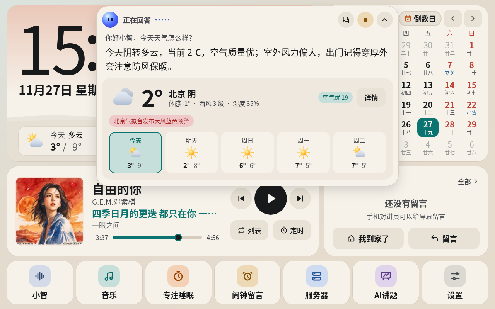
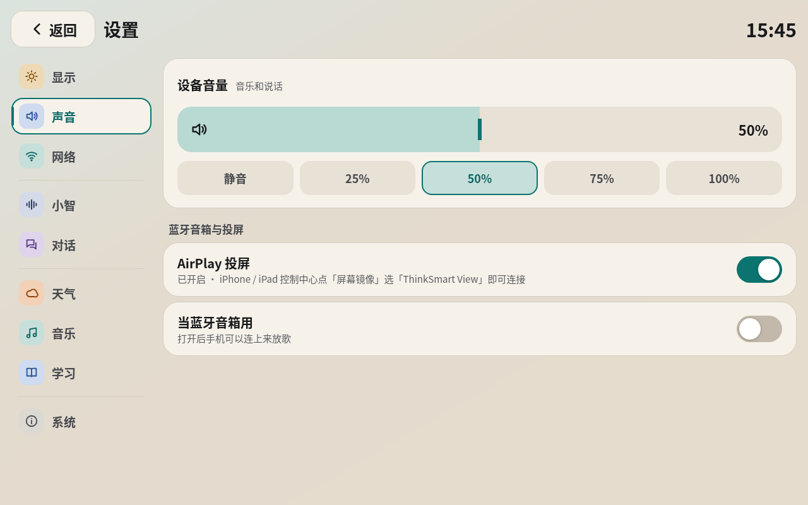
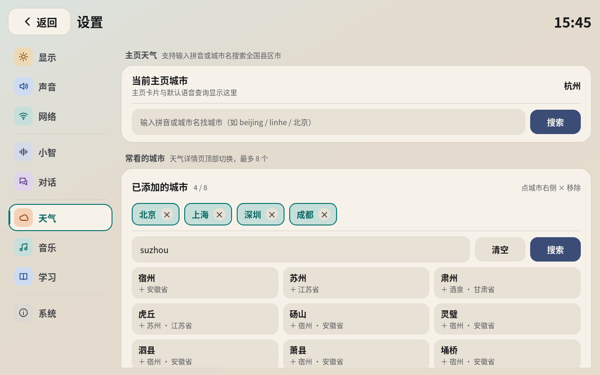
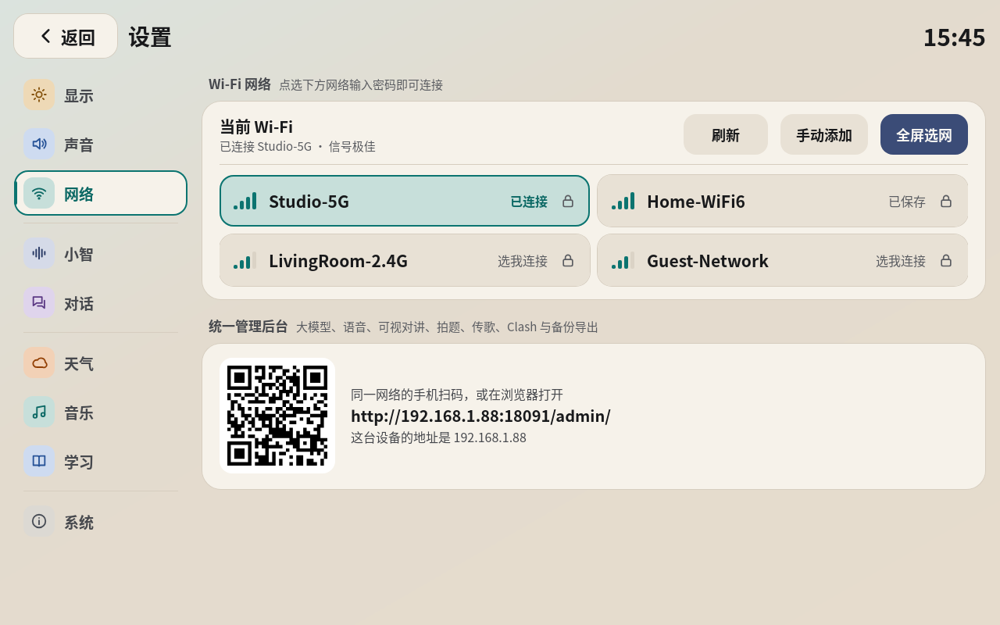
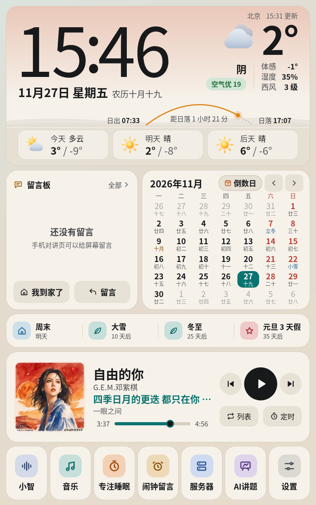
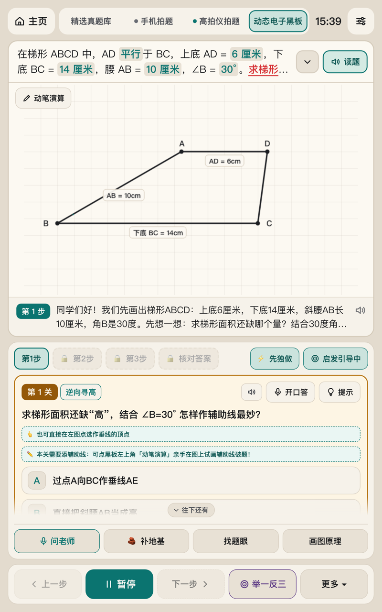
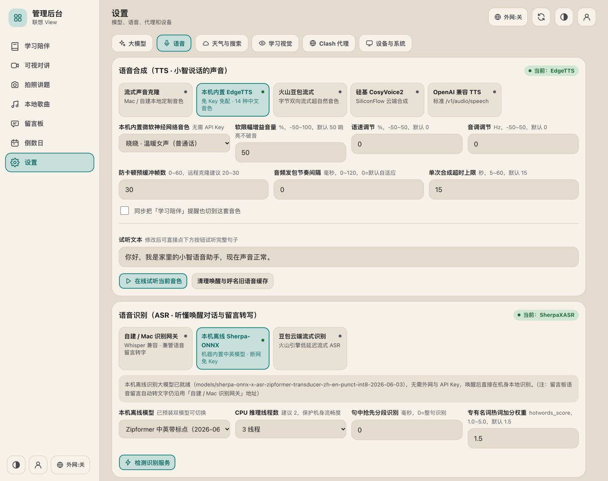
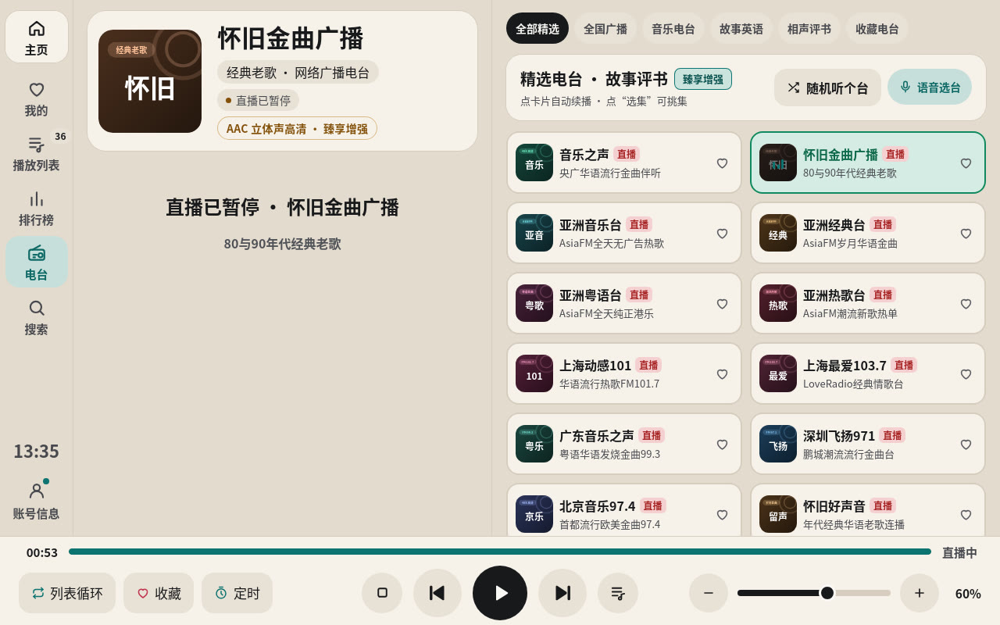

# ThinkSmart View (CD-18781Y) Unified Smart Desktop Hub & AI Blackboard Tutor

**[🇨🇳 简体中文](README.md) | [🇺🇸 English](README_EN.md)** · **[📘 Post-Install Setup & LLM Selection Guide](docs/USER_GUIDE_EN.md)**

Turn a Lenovo **ThinkSmart View (`CD-18781Y`: Qualcomm APQ8053 / 2GB RAM / 8GB eMMC / 8" `1280×800` IPS Touch Display / TAS5782M Hi-Fi Amp / Dual DMIC Array / S5KC505A Front Camera / BMA253 Accelerometer)** into an all-in-one **Ubuntu 24.04 + Wayland (Weston) + PipeWire Unified Voice Desktop Hub, AI Interactive Blackboard Tutor, and Web Admin Console**, with an optional **Apple Silicon Mac (`MLX` / `llama.cpp`)** local compute companion for low-latency voice cloning and E2EE vision inference.

---

## Key Highlights & Hardware Essentials

> [!IMPORTANT]
> **1. Native Unified Architecture (Dynamic Capsule + 9-Section Settings + Instant RAM Residency)**
> - **Fully Integrated Voice Dual-Core**: Both the voice client (`device/xiaozhi-client/`, `1.0.0-self`) and local voice hub (`device/xiaozhi-hub/`, `:16688`/`:16689`) are natively maintained in this repository with built-in WebRTC AEC audio bridging, 11 `self.*` device MCP tools, `64kbps` Opus, fast first-clause streaming TTS, and in-process PCM WAV decoding—permanently decoupled from unexpected third-party auto-updates.
> - **Top Dynamic Capsule + 11 Interactive Rich Cards**: Default wake word **`你好小智` (`Ni Hao Xiao Zhi`)**. Waking the assistant no longer switches away to a separate black screen—instead, a **Dynamic Capsule** and **touch-interactive Rich Media Card** (Weather, Music, Alarms, Timer, Countdowns, Messages, News, Server Probes, AI Tutor, Brightness, Volume) float right over your current view, with soft music ducking (`listen_duck`) during follow-up turns.
> - **9-Section Touch Settings & Sub-20ms Instant Open**: Built-in touch settings (`Display / Sound / Network / XiaoZhi / Chat / Weather / Music / Study / System`) with on-screen Wi-Fi picker, AirPlay & Bluetooth speaker switches, and **live Pinyin/Chinese city search**. Core services and subpages stay pre-warmed in RAM (`5–20 ms` instant response on 2GB RAM).

> [!TIP]
> **2. Unified Web Admin (`/admin/`) & AI Blackboard Tutor (`/tutor/`) Best Practices**
> - **Admin Initial Credentials & WAN Gate**: Open `http://<device-lan-ip>:18091/admin/` on LAN with initial username **`admin`** and password **`admin`**. **WAN access is OFF by default (`外网:关` / `WAN: OFF`, HTTP `403`)** until manually toggled inside the Admin Console. Includes **One-Click Full / Sanitized System Backup & Restore**.
> - **Portrait (`800×1280`) + Externally Powered USB Hub**: Standing the display upright clears the bottom Type-C cable path and matches A4/B5 worksheets; when connecting a **USB Document Camera** or **USB flash drive**, always use an **externally powered 5V/PD USB Hub** due to OTG current limits (`thinksmart-usb-host` & `thinksmart-usb-watchdog` handle auto-recovery).

---

## Brand-New Machine Complete Installation Guide (Step-by-Step)

> ⚠️ **Model Check**: Supports **ONLY Lenovo ThinkSmart View `CD-18781Y`** (Qualcomm `APQ8053`, 2GB RAM, 8GB eMMC). Does **NOT** support ThinkSmart View Plus. The unit has no power button and boots automatically when plugged in.

### Stage 1: Flash Base Ubuntu 24.04 Image on Factory Hardware (~15 min)

> If your unit is **already running** [`justhalfbit/thinksmart-ubuntu-image`](https://github.com/justhalfbit/thinksmart-ubuntu-image) with Wi-Fi and SSH working, **skip straight to Stage 2**!

1. **Prepare Host Tools & Base Images**:
   - Install [`bkerler/edl`](https://github.com/bkerler/edl) on a Windows / macOS / Linux PC (`> 20 GB` free disk space) with a data-capable USB-C cable connected directly to the computer. *(On Windows, the first time the unit enters EDL mode, use [Zadig](https://zadig.akeo.ie/) → `Options -> List All Devices` → select `QUSB__BULK (05C6:9008)` → install the **`WinUSB`** driver).*
   - Download and verify the 3 base files into a working folder:
     - `lk2nd.img` from [`rickx/ubuntu-thinksmart` prebuilt/lk2nd.img](https://github.com/rickx/ubuntu-thinksmart/raw/main/prebuilt/lk2nd.img) (`SHA256: c81b036c75028c3d5aa915c72c89e075bc044360fe964c2ec0afb1d4a6f5209b`)
     - `bootstrap-pmos-ssh-generic-qcom-msm8953.img` from [`rickx/ubuntu-thinksmart` bootstrap-2026-05-22](https://github.com/rickx/ubuntu-thinksmart/releases/tag/bootstrap-2026-05-22) (`SHA256: 7d79db19b0911647bf6ab0a9a2924ef5cf83b4674798a54acdcbd41cdf07921b`)
     - `thinksmart-ubuntu-20261101.img.xz` from [`justhalfbit/thinksmart-ubuntu-image` Releases](https://github.com/justhalfbit/thinksmart-ubuntu-image/releases), extracted via `xz -dk` or 7-Zip to `thinksmart-ubuntu-20261101.img` (`~3.46 GB`).
2. **Enter EDL (9008) Mode & Back Up Factory eMMC (Mandatory!)**:
   - Unplug power and USB, wait **30 seconds**, connect USB-C to the computer, **press and hold BOTH `Volume +` and `Volume −`**, plug in power, and release after **3–5 seconds** (screen remains black in EDL mode).
   - Verify hardware identity and dump a full factory backup (unique per device—never overwrite another unit's backup):
     ```bash
     edl printgpt 2>&1 | tee gpt-before.txt     # Confirm CPU "APQ8053" & total_blocks:15269888
     edl rf stock-full-emmc-unit1.bin           # Full 7.8 GB factory eMMC backup
     ```
3. **Flash Bootloader, Rewrite GPT Layout & Flash Ubuntu 24.04 Base**:
   - Flash `lk2nd` and `bootstrap` (re-enter EDL if needed):
     ```bash
     edl w boot lk2nd.img
     edl w system bootstrap-pmos-ssh-generic-qcom-msm8953.img
     edl reset
     ```
   - Wait for the `postmarketOS` console on the device display (with on-screen touch keyboard `fbkeyboard`), log in as `root`, and run:
     ```bash
     sudo /usr/local/sbin/apply-ubuntu-gpt.sh
     ```
   - Once **`GPT rewrite complete.`** appears, unplug power, wait **30 seconds**, hold `Volume +` and `Volume −` while plugging in power to re-enter EDL, and flash the Ubuntu image:
     ```bash
     edl w system thinksmart-ubuntu-20261101.img
     edl reset
     ```
   - On first boot, the root filesystem auto-expands to ~6.4 GB and opens the Wi-Fi welcome screen. Connect to Wi-Fi on the touchscreen, locate `<device-lan-ip>` from your router or LAN scan, and SSH in as `ubuntu` (change default `ubuntu` and `root` SSH passwords right away).

---

### Stage 2: One-Shot Deployment of This Full-Stack System (~2–3 min)

#### Option A: Online Git Clone Install (Recommended)

SSH into the freshly networked ThinkSmart View and run:

```bash
git clone https://github.com/fubin0478/thinksmart-view.git
cd thinksmart-view
bash device/install.sh --check          # Read-only directory & Python/Bash syntax check
sudo bash device/install.sh --apply     # Full idempotent install (camera DTB, UxPlay 1.74, AAC, all services)
sudo reboot                             # Reboot once to activate front camera DTB, audio rules & prewarmed services
```

#### Option B: Offline Bare-Metal Bundle & One-Step Config Cloning

For air-gapped installs or cloning an existing unit's settings onto a new unit:
- Export a backup from an existing unit via `http://<old-ip>:18091/admin/` → **System Backup / Restore** (or `sudo /usr/local/sbin/thinksmart-backup export --mode full --out /tmp/ts-backup.tar.gz`), and optionally build a standalone `~273 MiB` offline installer bundle via `python tools/build_baremetal_package.py --out-dir ./dist`.
- Deploy on the new unit:
  ```bash
  mkdir -p /tmp/ts-installer
  tar -xzf /tmp/thinksmart-baremetal-installer-20261125.tar.gz -C /tmp/ts-installer
  bash /tmp/ts-installer/install.sh --check
  sudo bash /tmp/ts-installer/install.sh --apply
  # Optional one-step restore from backup:
  # sudo bash /tmp/ts-installer/install.sh --apply --restore-backup /tmp/ts-backup.tar.gz
  sudo reboot
  ```

---

### Stage 3: Post-Reboot Verification & 3-Minute Setup

1. **Run Health Diagnostics**:
   ```bash
   /usr/local/bin/diagnose-wake.sh
   ```
   Confirm `0 errors, 0 warnings` (verifies `/dev/video0`, mic array, proximity/ALS blanker, AirPlay, and voice hub).
2. **Open Unified Web Admin (`http://<device-lan-ip>:18091/admin/`)**:
   - Log in with initial credentials **`admin` / `admin`** and update your admin password;
   - Add at least **one LLM API key** under **Large Models** (e.g., free Zhipu `glm-4-flash`, DeepSeek, Qwen, or OpenAI-compatible endpoint);
   - Optionally configure dedicated **3-tier AI Tutor vision/reasoning models** and **QWeather API keys** (see **[Post-Install Setup & LLM Selection Guide](docs/USER_GUIDE_EN.md)**).

---

## Live UI Showcase

### A. Unified Desktop & Dynamic Voice Capsule

| Top Dynamic Capsule + Interactive Rich Weather Card | Unified Desktop Home (Sunrise Arc / Lyrics / 7-Tile Dock) |
| :---: | :---: |
|  |  |

| 9-Section Settings (Touch Sliders / AirPlay / Bluetooth) | Live Pinyin/Chinese City Search & Multi-City Manager |
| :---: | :---: |
|  |  |

<details>
<summary>Expand: On-Screen Wi-Fi Picker + Admin QR (<code>1280×800</code>) & Standing Portrait Home (<code>800×1280</code>)</summary>

| Network Wi-Fi Picker & Unified Admin QR | Standing Portrait Home (`800×1280`) with Upcoming Strip |
| :---: | :---: |
|  |  |

</details>

---

### B. AI Blackboard Tutor (`800×1280` Portrait · Phone Upload + Doc-Cam Silent Co-Write)

| Portrait Dynamic Blackboard (`800×1280`) | USB Doc-Cam Silent Co-Write (`800×1280`) | Mobile Photo Studio (`/tutor/`) |
| :---: | :---: | :---: |
|  |  |  |

---

### C. Unified Web Admin Console (`:18091/admin/`) & Media / Server Dashboards

| Unified LLM Hub & `WAN: OFF` Gate | Dedicated 3-Tier AI Tutor Models | Built-in EdgeTTS & Offline Sherpa-ONNX ASR |
| :---: | :---: | :---: |
|  |  |  |

| Lossless QQ Music & 76 HD Radio Streams | Pomodoro Focus & Dual-Layer Soundscapes | Nezha Server Probe Dashboard |
| :---: | :---: | :---: |
|  |  |  |

---

## Repository Layout & Maintenance Tools

- `device/`: Full device stack (`xiaozhi-client`, `xiaozhi-hub`, `home`, `qqmusic`, `monitor`, `intercom`, `study`, `tutor`, `admin`, `kiosk`, `system`, `prebuilt/arm64`, `configs`, `tests`, and idempotent `install.sh`).
- `tools/`: Cross-platform `sync_device.py` (SHA256 diff, atomic backup & selective live sync) and `build_baremetal_package.py` (offline installer generator).
- `mac-companion/`: Optional Apple Silicon `MLX` voice cloning (`Qwen3-ASR` + `Qwen3-TTS`) & `Qwen3.5-9B` E2EE study-vision companion scripts.
- `docs/`: Bilingual post-install setup & model selection guides (`USER_GUIDE.md` / `USER_GUIDE_EN.md`).

---

## License

Copyright (c) 2026 fubin0478. Released under the [GNU General Public License v3.0 (GPL-3.0)](LICENSE) (hardware binaries in [`device/prebuilt/arm64/`](device/prebuilt/arm64/) follow their respective upstream open-source licenses; see [`device/prebuilt/arm64/README.md`](device/prebuilt/arm64/README.md)).
