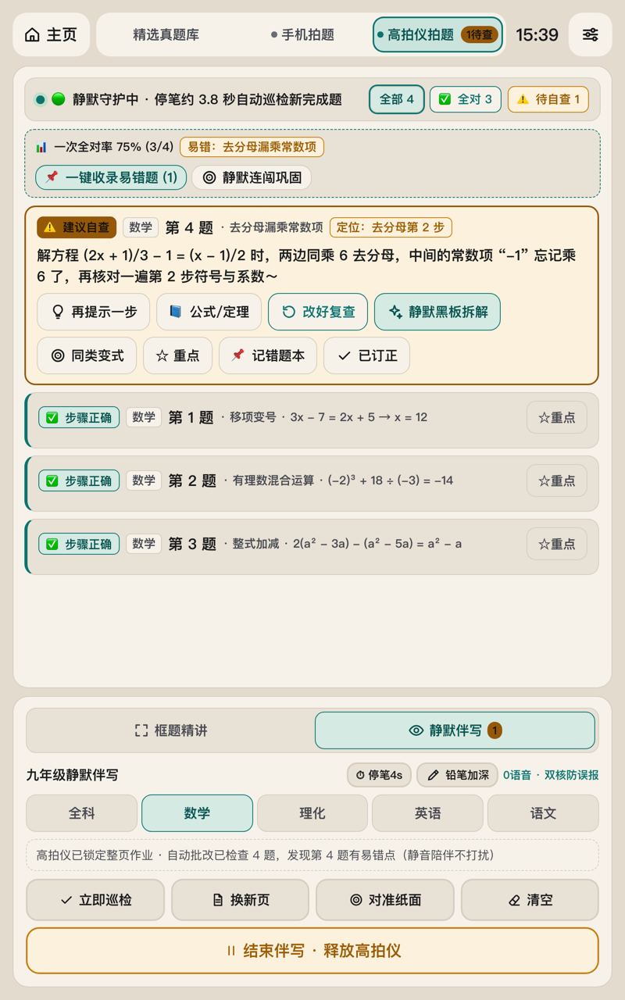
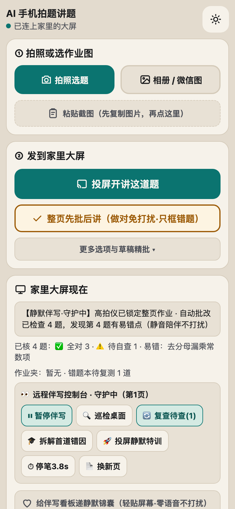
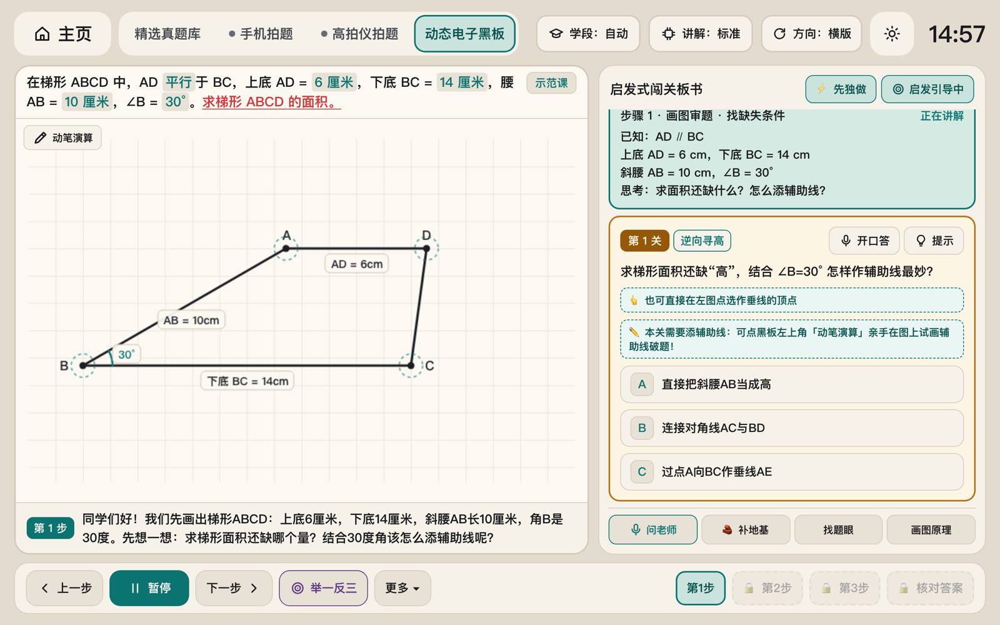
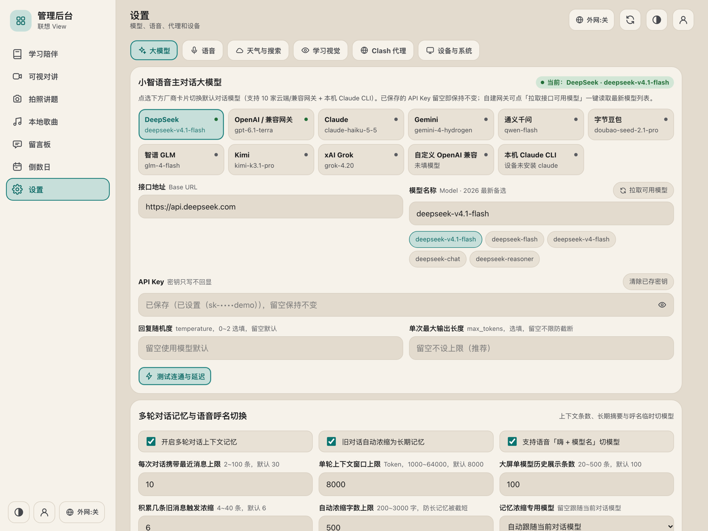
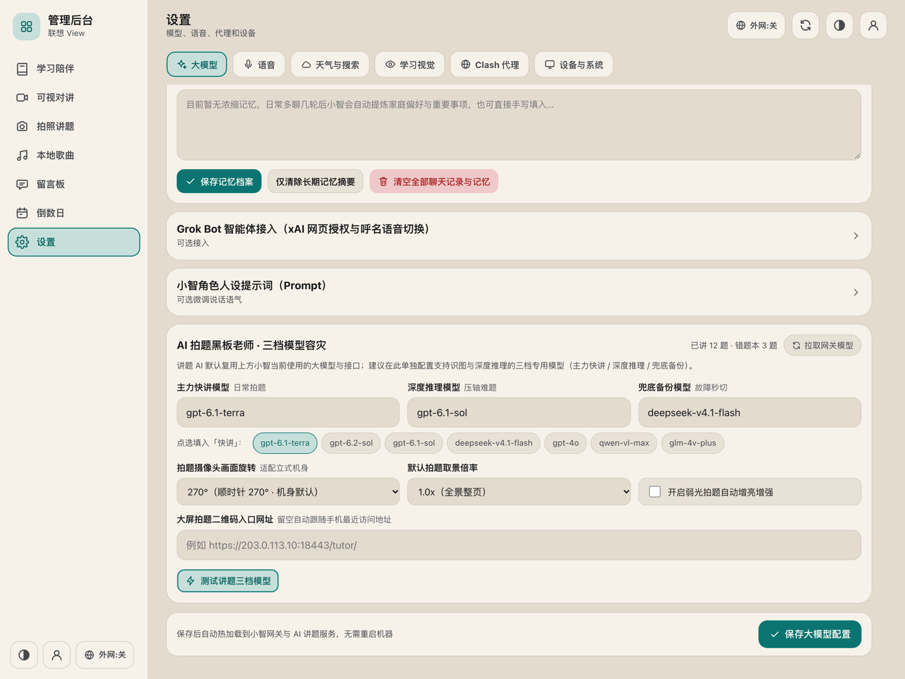
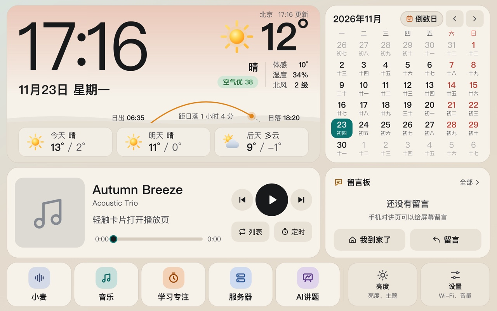
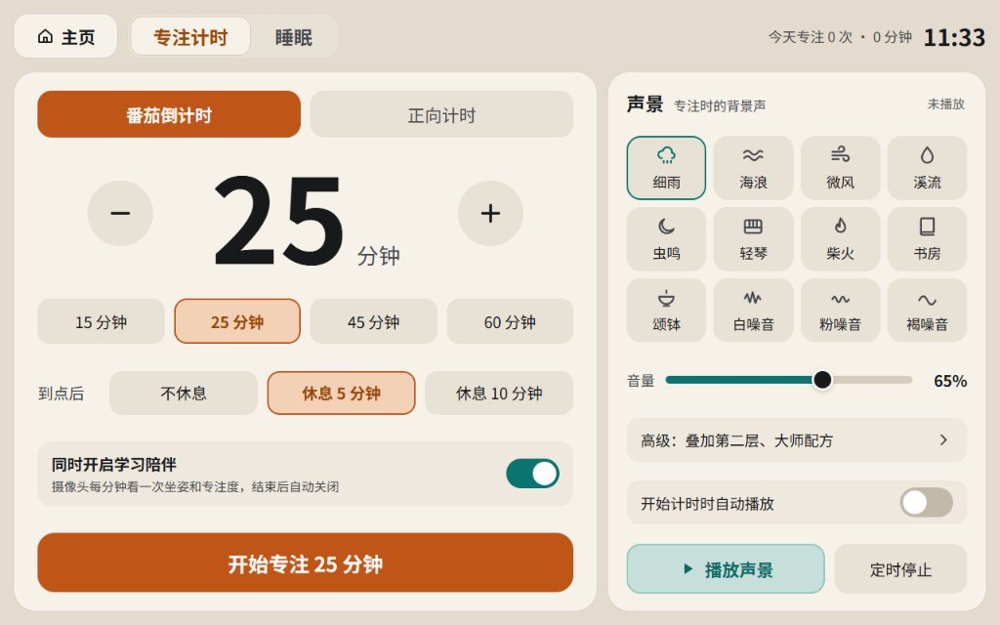
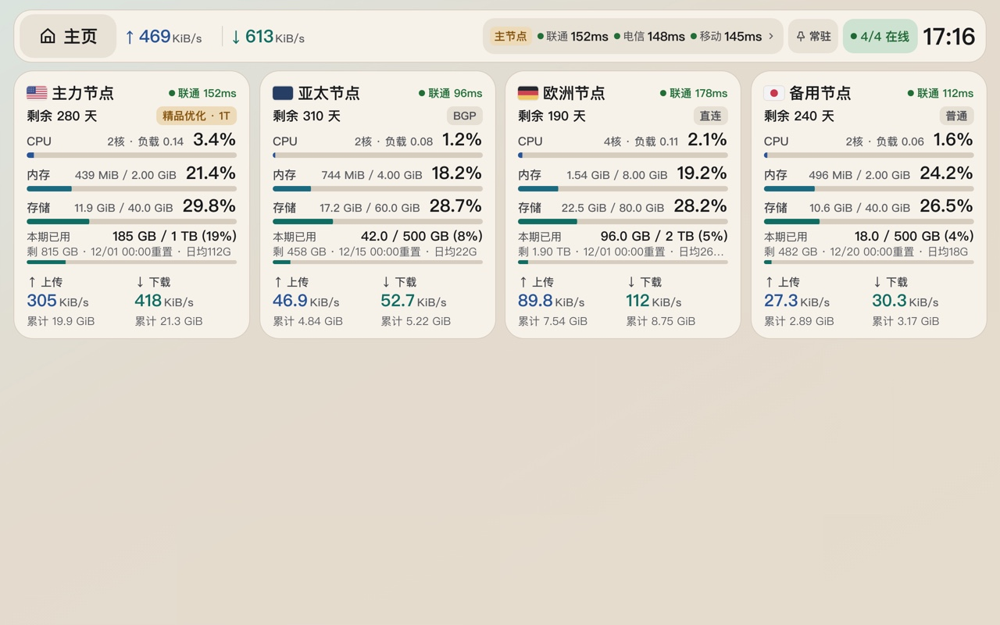
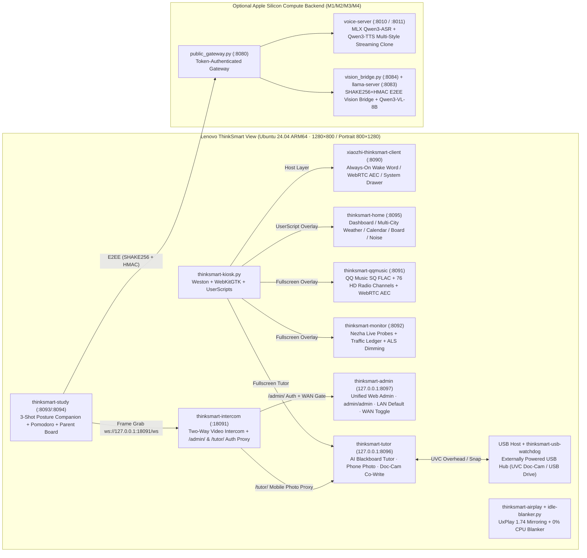

# ThinkSmart View (CD-18781Y) Smart Desktop Hub & AI Blackboard Tutor Suite

**[🇨🇳 简体中文](README.md) | [🇺🇸 English](README_EN.md)** · **[📘 Post-Install Configuration & LLM Selection Guide](docs/USER_GUIDE_EN.md)**

Transform a Lenovo **ThinkSmart View (`CD-18781Y`, Qualcomm APQ8053 / 8" 1280×800 IPS Touch Display / TAS5782M Hi-Fi Amp / Dual DMIC / S5KC505A Camera / BMA253 Gravity Sensor)** into an all-in-one **Ubuntu 24.04 + Wayland (Weston) + PipeWire Smart Desktop Hub, AI Interactive Blackboard Tutor, and Unified Web Admin Console**, with an optional **Apple Silicon Mac (MLX / llama.cpp)** local compute companion for zero-cloud voice cloning and E2EE vision inference.

> **Non-Invasive Decoupled Architecture**: All custom daemons live isolated in `/usr/local/{bin,sbin,share,lib}` and `/opt/thinksmart-addons/`. Upstream XiaoZhi voice client patches load via `sitecustomize.py` Git-Blob SHA verification, safely falling back on upstream updates so upgrades never brick the device.

---

## What's New & Essential Hardware / Security Notes

> [!IMPORTANT]
> **1. Unified Web Admin Console (`/admin/` · Default `admin` / `admin` · LAN-Only by Default)**
> - **Default Initial Credentials**: Fresh installations initialize username **`admin`** and password **`admin`** automatically (changeable in the Admin UI or via `sudo /usr/local/sbin/thinksmart-set-admin-password`).
> - **LAN-Only Access by Default**: Open `http://<device-lan-ip>:18091/admin/` from your home network to manage intercom, family messages, countdowns, posture monitoring, AI Tutor models, local songs, TTS/ASR voices, QQ Music, and proxy settings from one place.
> - **WAN Access OFF by Default (`外网:关` / `WAN: OFF`, returns HTTP `403`)**: Public/tunnel access to `/admin/` is strictly blocked after installation. If remote administration is needed, open the Admin Console over LAN and click the **`外网:关` (`WAN: OFF`) toggle button** in the top/sidebar bar to enable or disable WAN access manually (existing passwordless reverse-tunnel rules remain unchanged).

> [!TIP]
> **2. AI Interactive Blackboard Tutor (`/tutor/`) · Dual Input Modes & Hardware Best Practices**
> - **Mode 1 — Phone Photo Upload (`/tutor/` Mobile Studio)**: Scan the on-screen QR code or open `http://<device-lan-ip>:18091/tutor/` on your phone, snap a photo with perspective crop and shadow-free enhancement, and push it directly to the ThinkSmart View screen for **animated SVG blackboard explanations, synchronized voice teaching, interactive follow-up Q&A, and an Ebbinghaus spaced-repetition mistake book (`1/2/4/7/15` days)**.
> - **Mode 2 — USB Document Camera + Silent Co-Write**: Connect an overhead UVC Document Camera (`高拍仪`) for **touch-drag single-question tutoring** or **Silent Co-Write mode** (silently monitors full-page homework, triggers checks a few seconds after pen pause, and quietly flags subtle mistakes without interrupting focus).
> - **Portrait Orientation (`800×1280`) Strongly Recommended**: Standing the ThinkSmart View upright clears the bottom Type-C port cleanly for cabling and matches vertical A4/B5 worksheets and multi-step derivations. Built-in `BMA253` sensor auto-rotation works out of the box alongside manual orientation lock.
> - **Externally Powered USB Hub Required**: Because the bottom Type-C OTG port has strict current limits, **USB Document Cameras (`高拍仪`), USB flash drives (`U盘`), and other USB peripherals MUST connect through an externally powered (5V / PD) USB Hub** to prevent brownouts or disconnects. Built-in `thinksmart-usb-host` and `thinksmart-usb-watchdog` supervise xHCI host mode and auto-recover dropped UVC cameras.
> - **Dedicated AI Tutor LLMs (Defaults to XiaoZhi's Configured LLM)**: When left unconfigured, AI Tutor automatically inherits XiaoZhi's active LLM (`selected_module.LLM`). For reliable math/physics OCR, geometric auxiliary-line SVG generation, and deep reasoning, **configure a dedicated 3-tier model chain in Admin Console → Settings → Large Models → AI Tutor** (`Primary Fast`, `Deep Reasoning`, and `Backup`, see [`docs/USER_GUIDE_EN.md`](docs/USER_GUIDE_EN.md)).

---

## Showcase Gallery

### A. AI Blackboard Tutor (Recommended Portrait `800×1280` · Phone Photo + USB Doc-Cam Co-Write)

| Portrait Dynamic AI Blackboard (`800×1280`, Recommended) | Doc-Cam Silent Co-Write & Mistake Inspector (`800×1280`) | Mobile Photo Upload & Crop Studio (`/tutor/`) |
| :---: | :---: | :---: |
|  |  |  |
| **Animated SVG Geometry · Guided Steps · Interactive Ink** | **Pen-Pause Auto Check · Exact Step Pinpoint · Zero-Voice** | **LAN QR Upload · Perspective 4-Corner Crop · De-shadow** |

<details>
<summary>Expand: Landscape (<code>1280×800</code>) Blackboard Layout (auto-rotates via gravity sensor or manual toggle)</summary>



</details>

---

### B. Unified Web Admin Console (`/admin/` · Initial `admin` / `admin` · WAN Off by Default)

| Unified LLM Hub & `外网:关` (WAN OFF) Toggle | Dedicated 3-Tier AI Tutor Models & Doc-Cam Settings | Built-in EdgeTTS & Offline Sherpa-ONNX ASR |
| :---: | :---: | :---: |
|  |  |  |
| **Hot-Switch XiaoZhi Model · Explicit WAN Gate Indicator** | **Fast / Deep / Backup Chain · Inherits XiaoZhi by Default** | **Zero-Key 14 Neural Voices · On-Device Bilingual ASR** |

---

### C. Smart Desktop Hub (`1280×800` Touch Screen Core Views)

| Desktop Home Dashboard (Weather / Calendar / Messages) | Lossless QQ Music & 76 HD Radio / Audiobook Streams |
| :---: | :---: |
|  |  |
| **Multi-City Weather, Lunar Birthdays & Sun-Adaptive Themes** | **SQ FLAC Audio, 28 HD Music Streams, 48 Stories & Mastering EQ** |

| Pomodoro Focus Timer & Dual-Layer Soundscapes | Server Probe Dashboard & Billing Cycle Traffic |
| :---: | :---: |
|  |  |
| **Posture-Aware Study Mode & Fade-Out Sleep Noise Mixer** | **Nezha Multi-Node Carrier Latency & On-Demand WebSocket** |

---

## System Architecture



---

## Core Modules

### 1. Device Suite (`device/`)

| Directory | Service / Component | Key Highlights |
| --- | --- | --- |
| [`device/admin/`](device/admin/) | `thinksmart-admin.py` (`127.0.0.1:8097`, entry `:18091/admin/`) | **Unified Web Admin Console**: Single-page control center for XiaoZhi LLMs, TTS/voice cloning, offline Sherpa-ONNX & cloud ASR, wake-word hotwords/corrections, QWeather & search APIs, **3-tier AI Tutor models**, Doc-Cam & prompt settings, intercom, family board/countdowns, posture monitor, local music, and Clash proxy. Enforces **`admin`/`admin` initial credentials, LAN/VPN-first policy, and manual `WAN: OFF` gate**. |
| [`device/tutor/`](device/tutor/) | `thinksmart-tutor.py` (`127.0.0.1:8096`, mobile `:18091/tutor/`) | **AI Interactive Blackboard & Doc-Cam Co-Write**: Dual input via **Phone Photo Upload** (perspective crop & enhancement) and **USB Document Camera**. Features animated SVG geometry diagrams, guided hints, synchronized TTS narration, voice follow-ups, parameterized practice problems, **Ebbinghaus mistake book**, and **Silent Co-Write** full-page homework checking; inherits XiaoZhi's LLM by default; portrait `800×1280` recommended. |
| [`device/home/`](device/home/) | `thinksmart-home.py` (`:8095`) | **Smart Desktop Home**: QWeather multi-city forecast, 24h curves, 7-day range bars, 6-pollutant AQI, lunar/solar-term calendar, **3-device synced countdowns & lunar/leap-month birthdays**, bidirectional voice/text message board, dual-layer sleep soundscape mixer with sunrise wake-up, and Pomodoro focus timer. |
| [`device/qqmusic/`](device/qqmusic/) | `thinksmart-qqmusic.py` (`:8091`) | **Lossless Music & 76-Stream Radio**: QR login for Green Diamond SQ FLAC via `ffmpeg + SoXR (precision=28)` at `48kHz F32LE`, synced lyrics, 3 hardware mastering EQ presets, 76 curated radio/audiobook streams with resume memory, and WebRTC `aec.feed_far` hook for hands-free voice interruption. |
| [`device/monitor/`](device/monitor/) | `thinksmart-monitor.py` (`:8092`) | **Server Probe Dashboard & Overlay**: On-demand Nezha WebSocket (auto-disconnects 90s after close), billing-cycle traffic reconciliation, carrier latency charts, plus `home_overlay.js` providing `#tsVoicePill` across all fullscreen subpages. |
| [`device/intercom/`](device/intercom/) | `thinksmart-intercom.py` (`:18091`) | **Remote Video Intercom & Auth Gateway**: Controls onboard S5KC505A camera with physical shutter (`gpio87`), mic mute (`gpio86`), and `BMA253` auto-rotation; full-duplex calls, remote family board/countdown edits, and unified auth/WAN-gated reverse proxy for `/admin/` and `/tutor/` (reverse SSH tunnel script included). |
| [`device/study/`](device/study/) | `thinksmart-study.py` (`:8093` / `:8094`) | **AI Posture & Focus Companion**: Manual start with 3h safety lock, 3-frame burst across 8s filtered via **SHAKE256 + HMAC-SHA256 E2EE** to local/cloud VL model, gentle cloned/EdgeTTS nudges (yields to calls & AirPlay), and zero-image-retention parent analytics. |
| [`device/system/`](device/system/) | `idle-blanker.py` / `thinksmart-usb-watchdog` / `thinksmart-airplay.py` | **Power, USB Self-Healing & Casting**: Logarithmic ALS auto-dimming, `SIGSTOP` freezing of `WebKitWebProcess` for 0% blank-screen CPU, `thinksmart-usb-host` OTG switching for powered USB Hubs, `thinksmart-usb-watchdog` xHCI self-healing, and UxPlay 1.74 AirPlay scheduling. |
| [`device/prebuilt/arm64/`](device/prebuilt/arm64/) | `s5kc505a_cam_helper` / `uxplay` / `.dtb` | **Verified ARM64 Prebuilt Binaries**: Zero-idle 15fps soft-ISP camera helper + DTB overlay, patched `UxPlay 1.74`, `BMA253` NEON auto-rotate library, and PipeWire `FDK-AAC` Bluetooth encoder (with SHA256 checksums & DTS source). |
| [`device/xiaozhi-overrides/`](device/xiaozhi-overrides/) | `sitecustomize.py` + `files/` | **Non-Invasive XiaoZhi Hub Patches**: Git-Blob SHA verified runtime hooks enabling `64kbps` full-band Opus audio, streaming TTS improvements, music/tutor voice tools, and SSRF/admin security hardening. |
| [`device/configs/`](device/configs/) | `systemd` / `pam.d` / `pipewire` / `bluetooth` | **Hi-Fi Audio & System Hardening**: Native `48kHz` PipeWire clock, `wannamaker3` dithering, `thinksmart-admin.socket` (`:8097`), `thinksmart-tutor.socket` (`:8096`), `thinksmart-usb-watchdog.service`, and Wi-Fi power-save disablement. |
| [`device/tests/`](device/tests/) | `test_*.py` (29 test suites) | **Automated Regression Suite**: Covers Admin Auth & WAN/LAN gating, Portrait UI sizing, Doc-Cam Silent Co-Write, USB Hub hotplug, lunar/leap-month countdowns, multi-city weather, radio resume, and server monitor security bounds. |

### 2. Apple Silicon Companion (`mac-companion/`, Optional)

| Directory | Component | Highlights |
| --- | --- | --- |
| [`mac-companion/voice-server/`](mac-companion/voice-server/) | `server.py` + `tts_speedups.py` + `public_gateway.py` | **MLX Local ASR + Streaming Voice Clone (`:8010` / `:8011`)**: `Qwen3-ASR-1.7B` & `Qwen3-TTS-12Hz-1.7B-Base` achieving `~300ms` TTFT on M1 Pro with 4-style rotation, overflow worker spawning, and idle memory unloading. |
| [`mac-companion/study-vision/`](mac-companion/study-vision/) | `vision_bridge.py` + `llama-server` | **E2EE Vision Bridge (`:8084` -> `:8083`)**: Stdlib `SHAKE256 + HMAC-SHA256` encryption with `120s` replay guard, gravity-aware `sips` rotation, and local `Qwen3-VL-8B-Instruct` or cloud VL forwarding. |

---

## Directory Structure

```text
thinksmart-view/
├── README.md                 # Chinese overview & deployment guide
├── README_EN.md              # English overview & deployment guide
├── docs/
│   ├── USER_GUIDE.md         # Post-install setup & model guide (Chinese)
│   ├── USER_GUIDE_EN.md      # Post-install setup & model guide (English)
│   └── images/               # Clean documentation screenshots (EXIF & PII stripped)
├── device/
│   ├── install.sh            # Idempotent installer, dependency sync, admin:admin init & upgrade
│   ├── diagnose-wake.sh      # Read-only health check for sockets, USB watchdog, camera & wake path
│   ├── admin/                # Unified Web Admin Console (:8097 loopback, :18091/admin/ entry)
│   ├── tutor/                # AI Blackboard Tutor, Phone Photo Studio & Doc-Cam Co-Write (:8096, :18091/tutor/)
│   ├── home/                 # Smart Home dashboard, weather, calendar, message board & focus timer (:8095)
│   ├── qqmusic/              # Lossless QQ Music, 76 HD radio streams & WebRTC AEC hook (:8091)
│   ├── monitor/              # Nezha server monitor & persistent top overlay (:8092)
│   ├── intercom/             # Video intercom, /admin/ & /tutor/ auth gateway & reverse SSH tunnel template (:18091)
│   ├── study/                # AI posture & focus companion (:8093 / :8094)
│   ├── kiosk/                # First-boot Wi-Fi captive setup & virtual keyboard
│   ├── prebuilt/arm64/       # Camera soft-ISP, DTB overlay, UxPlay 1.74, NEON rotation & FDK-AAC
│   ├── system/               # ALS blanker, USB Host/Watchdog, AirPlay scheduler & Kiosk launcher
│   ├── xiaozhi-overrides/    # Git-Blob verified runtime overrides for XiaoZhi Hub
│   ├── configs/              # systemd (incl. admin/tutor sockets & usb-watchdog), PipeWire, Bluetooth, udev
│   └── tests/                # 29 automated regression test suites
└── mac-companion/
    ├── install-mac.sh        # One-shot Apple Silicon venv & LaunchAgent setup
    ├── voice-server/         # MLX Qwen3-ASR + Qwen3-TTS streaming clone & gateway
    └── study-vision/         # E2EE study-vision bridge & Qwen3-VL LaunchAgent templates
```

---

## Quick Deployment

### Prerequisites: Base Image & Two-Step Install

> **Where to log in, toggle WAN access, and pick AI models?** 👉 Read **[Post-Install Configuration & LLM Selection Guide](docs/USER_GUIDE_EN.md)**.

1. **Step 1 — Flash the XiaoZhi Community Ubuntu 24.04 Image**:
   - Follow [`justhalfbit/thinksmart-ubuntu-image`](https://github.com/justhalfbit/thinksmart-ubuntu-image) to flash `Lenovo ThinkSmart View (CD-18781Y)` with preinstalled `xiaozhi-thinksmart-client` (`thinksmart-client.service` `:8090`) and `xiaozhi-hub-server` (`:16688`).
2. **Step 2 — Run Our One-Shot Overlay Installer**:
   ```bash
   git clone https://github.com/fubin0478/thinksmart-view.git
   cd thinksmart-view
   sudo bash device/install.sh
   sudo reboot
   # Verify all services, sockets, USB watchdog & wake pipeline after reboot:
   bash device/diagnose-wake.sh
   ```

`device/install.sh` is safe to re-run for upgrades and handles:
- Installing missing `apt` packages (`python3-dbus`, `python3-gi`, `python3-smbus2`, `python3-yaml`, `python3-ruamel.yaml`, `python3-pil`, `v4l-utils`, `ffmpeg`, `gstreamer1.0-plugins-bad`, `libfdk-aac2`) and building `/opt/thinksmart-addons/venv`.
- Enabling socket-activated **`thinksmart-admin.socket` (`127.0.0.1:8097`)**, **`thinksmart-tutor.socket` (`127.0.0.1:8096`)**, and **`thinksmart-usb-watchdog.service`**.
- **Initializing Default Admin Auth & WAN Gate** (fresh installs only — upgrades never overwrite existing `auth.json` or `wan_access.json`):
  - **Initial Username & Password**: **`admin`** / **`admin`**
  - **LAN Login URL**: **`http://<device-lan-ip>:18091/admin/`** (restricted to LAN & trusted VPN/tunnel subnets by default)
  - **WAN Access**: **Disabled (`外网:关`, HTTP `403`)** by default; toggleable manually via the button inside the Admin Console.
- CLI password reset at any time:
  ```bash
  printf 'admin:YourStrongPassword\n' | sudo /usr/local/sbin/thinksmart-set-admin-password
  ```

> [!WARNING]
> **Powered USB Hub Requirement**: Plugging an unpowered USB hub with a UVC Document Camera (`高拍仪`) or USB drive (`U盘`) directly into the bottom Type-C port can trip current limits and drop the camera. Always connect USB peripherals via an **externally powered 5V/PD USB Hub**, ideally paired with **Portrait orientation**.

### Optional: Apple Silicon Compute Companion

Skip this completely if you do not have an always-on Apple Silicon Mac—on-device **EdgeTTS** + offline **Sherpa-ONNX ASR** plus cloud LLM APIs work out of the box.

```bash
bash mac-companion/install-mac.sh
bash mac-companion/voice-server/manage.sh start all
bash mac-companion/voice-server/manage.sh status
```

---

## Privacy & Security Architecture

- **Zero Credentials in Repository**: All real IPs, hostnames, ports, API keys, MAC addresses, and PNG EXIF/ancillary chunks are stripped before committing. Password hashes and API keys exist only at runtime on the device under strict `0600`/`0700` permissions.
- **LAN-First Admin + Explicit WAN Gate**: Even if you run a reverse SSH tunnel for remote intercom viewing, `/admin/` rejects tunnel traffic (`403`) until you explicitly enable the WAN switch in the Admin Console.
- **Host / Origin / SSRF & E2EE Guards**: Strict `Host`/`Origin` validation, private-network SSRF filtering on config endpoints, and `SHAKE256 + HMAC-SHA256` replay-protected E2EE frames with zero photo disk retention in posture companion mode.

---

## License

[MIT License](LICENSE) (hardware binaries in [`device/prebuilt/arm64/`](device/prebuilt/arm64/) follow their respective upstream open-source licenses; see [`device/prebuilt/arm64/README.md`](device/prebuilt/arm64/README.md)).
